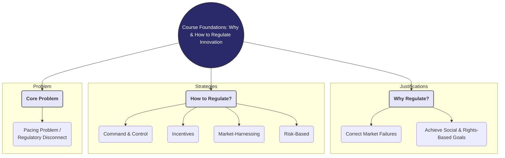
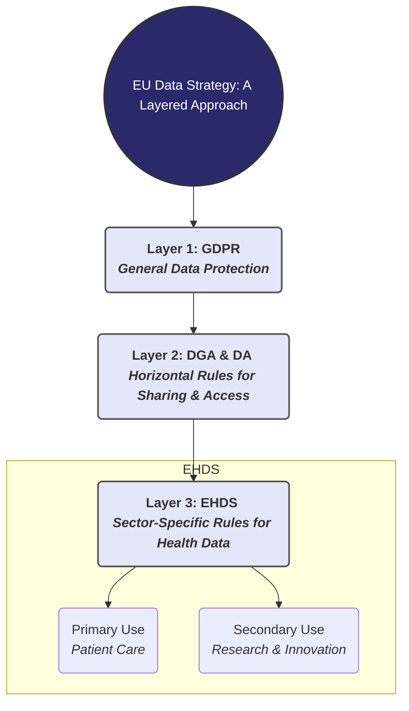
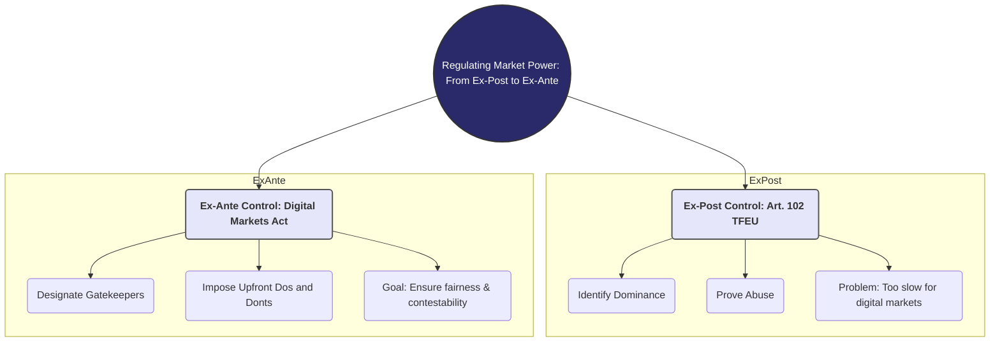
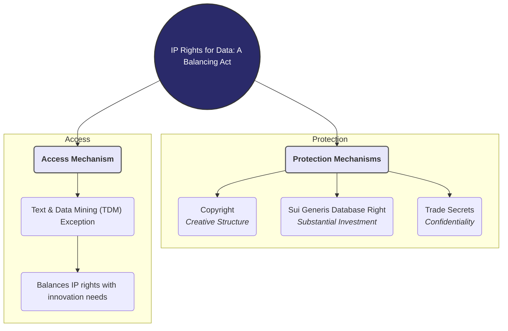
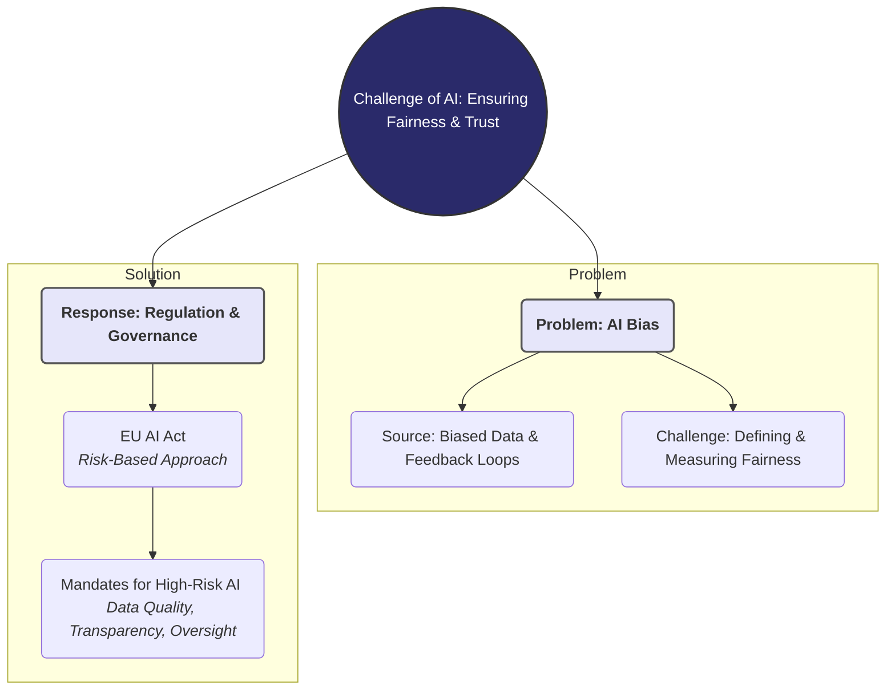

# Brief Summary of the Full Course: Innovation & Regulation

This summary provides a holistic overview of the key themes from the entire course, connecting the foundational concepts of regulation with the specific challenges posed by data, competition, intellectual property, and artificial intelligence.

## 1. Module 1: Foundations of Innovation and Regulation

This module establishes the fundamental concepts of the course. Regulation is defined as any intentional effort to channel behavior, justified by the need to correct market failures (e.g., monopolies, externalities), achieve social goals, or protect fundamental rights. A key challenge is the "pacing problem," where law struggles to keep up with technology. This leads to various regulatory strategies, from traditional command-and-control to modern risk-based and market-harnessing approaches.

- **Innovation**: A three-part concept of invention, diffusion, and positive social impact.
- **Why Regulate?**: To address market failures, social goals, and protect rights.
- **Regulatory Strategies**: A diverse toolkit including command-and-control, incentives, disclosure, and risk-based regulation.
- **Core Challenge**: The "Collingridge Dilemma" and the pacing problem of law vs. technology.

## 2. Module 2: Data Governance and Health Data

This module applies the foundational concepts to data, focusing on the EU's multi-layered strategy. It starts with the **GDPR** as the baseline for protecting personal data. On top of this, the **Data Governance Act (DGA)** and **Data Act (DA)** create horizontal frameworks to facilitate trustworthy data sharing and ensure fair value allocation. Finally, the **European Health Data Space (EHDS)** provides a sector-specific example, creating rules for both the primary use (patient care) and controversial secondary use (research, innovation) of sensitive health data, often without specific consent.

- **EU Data Strategy**: A layered approach from general to specific regulation.
- **Horizontal Laws**: GDPR (protection), DGA (sharing processes), DA (fairness/access).
- **Sector-Specific Law**: The EHDS balances individual privacy with public health innovation.

## 3. Module 3: Competition Law in the Digital Age

This module examines how competition law adapts to data-driven markets. Traditional *ex-post* enforcement via **Article 102 TFEU** (prohibiting abuse of dominance) has proven too slow to address the "pacing problem" in digital markets, where network effects and data advantages lead to rapid "tipping." In response, the EU introduced the **Digital Markets Act (DMA)**, an *ex-ante* regulation that imposes a list of "dos and don'ts" on designated "gatekeeper" platforms to ensure markets remain fair and contestable.

- **Traditional Tool**: Article 102 TFEU (ex-post), targeting abuse of dominance.
- **Problem**: Too slow for fast-moving digital markets (the "enforcement gap").
- **New Tool**: The Digital Markets Act (ex-ante), setting upfront rules for gatekeepers.

## 4. Module 4: Intellectual Property and Data

This module explores how Intellectual Property (IP) law governs data. It establishes that raw facts cannot be "owned." Instead, IP protects the investment and creativity related to data through three main tools: **Copyright** (for creative database structures), the **Sui Generis Database Right** (for substantial investment in contents), and **Trade Secrets** (for commercially valuable, confidential information). A key development is the **Text and Data Mining (TDM) exception**, which allows data analysis for research and innovation, with an opt-out for commercial use, balancing IP rights with the needs of a data-driven economy.

- **Core Principle**: No ownership of raw data.
- **Protection Mechanisms**: Copyright, Sui Generis Database Right, Trade Secrets.
- **Balancing Act**: The TDM exception allows data analysis while respecting rightholder opt-outs.

## 5. Module 5: AI Fairness, Bias, and Data Quality

This final module addresses the ethical and legal challenges of AI. It identifies that AI bias is not intentional but stems from flaws in the AI lifecycle, especially **biased data** (historical, representation bias) and **feedback loops**. "Fairness" itself is complex, with competing mathematical definitions (group vs. individual) that cannot all be satisfied simultaneously. The EU's response is the **AI Act**, which uses a risk-based approach. For high-risk systems, it mandates strict requirements on **data quality, transparency, and human oversight** to mitigate bias and ensure trustworthiness.

- **Problem**: AI bias arises from flawed data and feedback loops, not malice.
- **Challenge**: "Fairness" is a complex, multi-faceted concept with inherent trade-offs.
- **Response**: The EU AI Act imposes strict data governance, transparency, and oversight requirements on high-risk systems.

