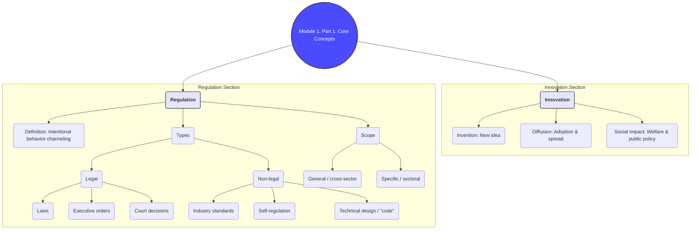
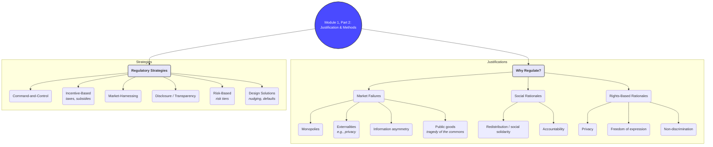
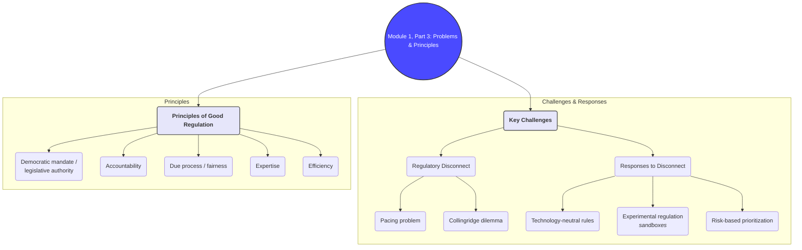

# Brief Summary of Module 1: Introduction to Innovation & Regulation

This summary provides a concise overview of the essential concepts from Module 1, drawing from `lecture_1.md` and `lecture_2.md`, and integrating key ideas from the supplementary readings.

## 1. Core Definitions

### What is Innovation?
Innovation is more than just a new idea. Following Butenko & Larouche (2015), it is a three-part concept:
1.  **Invention**: A novel idea or creation.
2.  **Diffusion**: The successful adoption and spread of the invention among users or in the market.
3.  **Positive Social Impact**: The innovation contributes to social welfare or public policy goals.

This definition bridges the gap between the "law and economics" perspective, which focuses on market diffusion, and the "law and technology" view, which emphasizes the societal and ethical impact.
*(Source: `Module_1/lecture_1.md`, `Module_1/Regulation for Innovativeness or Regulation of Innovation - Butenko & Larouche.md`)*

### What is Regulation?
Regulation is broadly defined as any intentional effort to channel behavior. This includes:
- **Formal legal instruments**: Laws, executive orders, and court decisions (e.g., GDPR, Digital Services Act).
- **Non-legal instruments**: Industry standards, self-regulation, and even technology itself ("Code is Law").

Regulation can be general (applying across sectors, like competition law) or specific (targeting a single industry, like finance or healthcare).
*(Source: `Module_1/lecture_1.md`)*

## 2. Why Regulate Innovation?

Regulation is justified by several rationales, primarily categorized as economic, social, and rights-based.

### Economic Rationales (Market Failures)
The primary economic justification for regulation is to correct **market failures**, where the free market fails to produce an optimal outcome. Key failures in the context of innovation include:

- **Monopolies**: A single firm dominates, leading to higher prices and reduced output. Data markets are prone to this due to network effects. Policy response is often competition law. *(Source: `Module_1/lecture_1.md`)*
- **Externalities (Spillovers)**: The price of a product does not reflect its true social cost or benefit. For data, this includes privacy externalities (uncompensated data use) and information externalities. *(Source: `Module_1/lecture_1.md`)*
- **Information Asymmetries**: Consumers lack the information to make rational choices, a problem exacerbated in complex data markets. *(Source: `Module_1/lecture_1.md`)*
- **Public Goods**: Goods that are non-excludable and non-rivalrous (like clean air or, arguably, data) are often under-produced or over-exploited (Tragedy of the Commons) without regulation. Property rights are a common, though imperfect, solution. *(Source: `Module_1/lecture_1.md`, `Module_1/why data ownership is the wrong approach.md`)*

### Social and Rights-Based Rationales
Regulation also serves non-economic goals:
- **Social Solidarity**: Ensuring access to essential services (e.g., healthcare, transport) and addressing redistribution issues.
- **Accountability**: Holding powerful actors, especially in data-driven markets, accountable for their societal influence.
- **Protection of Fundamental Rights**: Safeguarding human rights such as privacy, freedom of expression, and non-discrimination from the impacts of new technologies.
*(Source: `Module_1/lecture_1.md`, `Module_1/Understanding_Regulation, Baldwin et al 2012- Why Regulate.md`)*

## 3. Key Regulatory Strategies

Regulators employ various strategies to influence behavior, each with distinct strengths and weaknesses.

| Strategy | Description | Application Example |
| :--- | :--- | :--- |
| **Command-and-Control** | Imposing mandatory standards backed by sanctions. | Banning a specific harmful technology or requiring platforms to remove illegal content within a set timeframe. |
| **Incentive-Based** | Using economic incentives (taxes, subsidies) to encourage desired behavior. | Tax credits for green technology R&D. |
| **Market-Harnessing** | Using market forces to achieve regulatory goals. | The EU's Digital Markets Act (DMA) requires "gatekeepers" to share data to foster competition. |
| **Disclosure (Transparency)** | Requiring the publication of information to empower consumers and public scrutiny. | The EU's Digital Services Act (DSA) mandates transparency reports from platforms on content moderation. |
| **Risk-Based** | Prioritizing regulatory action based on the assessed level of risk. | The EU's AI Act categorizes AI systems by risk level (high, low, etc.) and applies rules accordingly. |
| **Design Solutions (Nudging)** | Structuring the "choice architecture" to guide behavior without coercion. | Setting privacy-protective options as the default in software. |

*(Source: `Module_1/lecture_2.md`, `Module_1/Understanding_Regulation, Baldwin et al 2012- Regulatory strategies.md`)*

## 4. The Challenge of Regulatory Disconnect

A central problem in regulating innovation is the **"pacing problem"** or **"regulatory disconnect"**: technology often develops faster than the law can adapt. This leads to:
- **Regulatory Gaps**: New technologies emerge in a legal void.
- **Regulatory Obsolescence**: Existing laws become outdated and ill-suited for new realities.
- **The Collingridge Dilemma**: In the early stages of a technology, its impacts are unknown, making regulation difficult. By the time the impacts are clear, the technology is so entrenched that changing it is costly and difficult.

Approaches to manage this include **risk-based regulation**, **experimental legislation** (e.g., regulatory sandboxes), and adopting **technology-neutral** principles.
*(Source: `Module_1/lecture_2.md`, `Module_1/Regulation for Innovativeness or Regulation of Innovation - Butenko & Larouche.md`)*

## 5. What Constitutes 'Good' Regulation?

"Good" regulation is evaluated against several criteria, which often exist in tension:
- **Legislative Authority**: Is it based on a clear democratic mandate?
- **Accountability**: Is the regulator answerable to public institutions?
- **Due Process**: Are the procedures fair, open, and accessible?
- **Expertise**: Does the regulator possess the necessary knowledge?
- **Efficiency**: Does it achieve its goals with minimal cost?

Finding the right balance is key to creating a regulatory regime that is both effective and legitimate.
*(Source: `Module_1/lecture_2.md`, `Module_1/Understanding_Regulation_Theory_Strategy_and_Pract..._----_(3_What_is_‘Good’_Regulation_).md`)*

---

