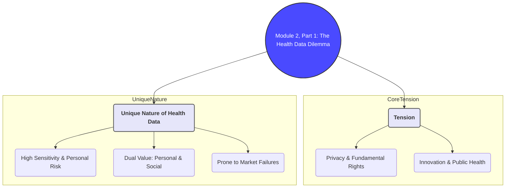
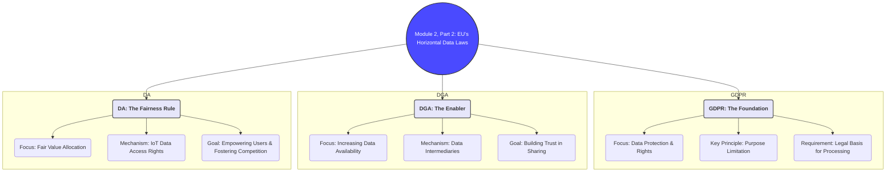
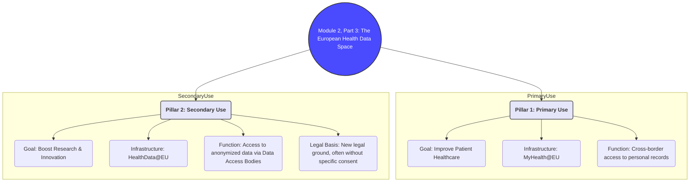

# Brief Summary of Module 2: Health Data Sharing & EU Regulation

This summary provides a concise overview of the essential concepts from Module 2, drawing from the core lectures (`Health data sharing pt 1.md`, `Health data sharing pt 2.md`) and integrating key ideas from supplementary materials on the EU's data strategy.

## 1. The Challenge of Health Data

Health data is unique due to its high sensitivity and immense value. This creates a fundamental tension between protecting individual privacy and unlocking societal benefits through data sharing for research and innovation.

### Why is Health Data Different?
- **High Personal Risk**: Unauthorized disclosure can lead to discrimination, stigmatization, and personal distress. This makes privacy a paramount concern.
- **Dual Value**:
    1.  **Personal Value**: Essential for an individual's own healthcare.
    2.  **Social/Economic Value**: Aggregated and anonymized data is a critical resource for public health policy, scientific research, and developing new treatments.
- **Market Failures**: The health data market is prone to failures like information asymmetries (patients don't know how their data is used) and externalities (data use can have societal benefits/harms not reflected in the transaction).

This situation necessitates a robust regulatory framework that can build trust and balance the competing interests of data protection and data-driven innovation.
*(Source: `Module_2/Health data sharing pt 1.md`)*

## 2. The EU's General Data Regulation Framework

The EU has developed a multi-layered strategy to govern data, moving from general principles to specific applications. This framework sets the stage for how health data is managed.

### Key Legislative Pillars
- **General Data Protection Regulation (GDPR)**: The foundation for data protection. It establishes core principles like purpose limitation, data minimization, and lawfulness of processing. It grants data subjects strong rights (access, rectification, erasure). For health data, it requires explicit consent or another specific legal basis for processing.
- **Data Governance Act (DGA)**: Aims to increase the availability of data by creating trustworthy mechanisms for data sharing. It introduces "data altruism" organizations and "data intermediation services" to facilitate sharing in a neutral, secure way. It focuses on processes and trust.
- **Data Act (DA)**: Aims to create fairness in the digital economy by clarifying who can create value from data. A key provision grants users the right to access and share data generated by their connected (IoT) devices, including health and wellness trackers. It focuses on access and fairness.

These regulations are horizontal, meaning they apply across all sectors, but they work together to create an environment where data can be both protected and utilized.
*(Source: `Module_2/Health data sharing pt 1.md`, `Module_2/Health data sharing pt 2.md`, `Module_2/OJ_L_202500327_EN_TXT.md`)*

## 3. The European Health Data Space (EHDS)

The EHDS is a sector-specific regulation designed to create a single market for health data in the EU. It builds upon the GDPR, DGA, and DA to address the unique needs of the health sector. It establishes two distinct pillars for data use.

### Pillar 1: Primary Use of Health Data
This pillar focuses on empowering individuals with control over their own health data for their own healthcare.
- **Goal**: Improve healthcare delivery across the EU.
- **Mechanism**: The **MyHealth@EU** infrastructure.
- **Functionality**: Allows citizens to access and share their electronic health records (e.g., e-prescriptions, patient summaries) with healthcare providers, even when in another Member State. This ensures continuity of care.
- **Legal Basis**: Primarily relies on individual access and control, consistent with GDPR data portability rights.

### Pillar 2: Secondary Use of Health Data
This pillar focuses on making health data available for research, innovation, and public policy purposes.
- **Goal**: Boost health research and innovation for the public good.
- **Mechanism**: The **HealthData@EU** infrastructure, connecting national **Health Data Access Bodies (HDABs)**.
- **Functionality**: Researchers or companies can apply to an HDAB for access to anonymized or pseudonymized health data. Access is granted within a secure processing environment, meaning the data itself does not leave the controlled system.
- **Legal Basis**: This is the most controversial aspect. The EHDS creates a new legal basis for secondary use, often **without requiring specific consent** from the individual, provided the purpose is in the public interest. This creates a significant exception to the GDPR's principle of purpose limitation.

*(Source: `Module_2/Health data sharing pt 2.md`, `Module_2/European Health Data Space.md`, `Module_2/IPOL_STU(2022)740054_EN.md`)*

