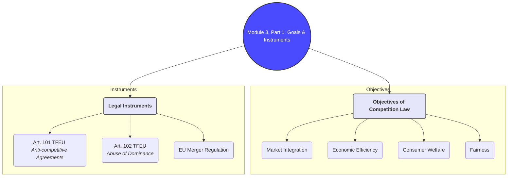
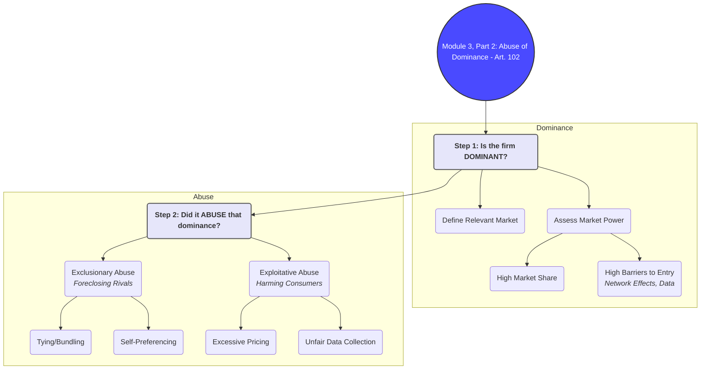
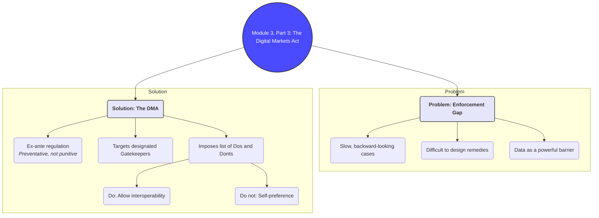

# Brief Summary of Module 3: Competition Law in the Digital Age

This summary provides a concise overview of the essential concepts from Module 3, drawing from the core lecture (`Lecture Competition Law - MOK - FINAL.md`) and integrating key ideas from supplementary materials on EU competition policy and the role of data.

## 1. The Goals and Instruments of EU Competition Law

EU competition law aims to protect the competitive process within the single market to ensure lower prices, higher quality goods, and more innovation. It is not designed to protect individual competitors, but rather the market structure itself.

### Core Objectives
- **Market Integration**: Ensuring the EU functions as a single, unified market.
- **Economic Efficiency**: Promoting the efficient allocation of resources.
- **Consumer Welfare**: Maximizing consumer choice, quality, and innovation while ensuring fair prices.
- **Fairness**: Preventing dominant companies from abusing their power and ensuring a level playing field.

### Main Legal Instruments
The primary tools are found in the Treaty on the Functioning of the European Union (TFEU):
- **Article 101 TFEU**: Prohibits anti-competitive agreements between undertakings (e.g., cartels, price-fixing).
- **Article 102 TFEU**: Prohibits the abuse of a dominant market position by a single undertaking.
- **EU Merger Regulation**: Controls mergers and acquisitions that could significantly impede effective competition.

These tools are enforced by the European Commission and National Competition Authorities (NCAs).
*(Source: `Module_3/Lecture Competition Law - MOK - FINAL.md`, `Module_3/European Parliament - EU Competition Policy Factsheet 2024.md`)*

## 2. Article 102 TFEU: Abuse of a Dominant Position

Article 102 is central to regulating large tech platforms. A violation requires two key elements: **dominance** on a relevant market and an **abuse** of that dominance.

### Step 1: Establishing Dominance
- **Define the Relevant Market**: This involves defining the product market (what products are interchangeable?) and the geographic market. In digital markets, markets are often defined narrowly (e.g., "market for Android app stores").
- **Assess Market Power**: Dominance is the ability to behave independently of competitors and consumers. Indicators include:
    - **High Market Share**: Often above 50%, but not sufficient on its own.
    - **Barriers to Entry**: High barriers make it difficult for new players to challenge the incumbent. In digital markets, these include network effects, economies of scale, and access to data.
    - **Control of Essential Infrastructure**: Owning a key platform or dataset can confer dominance.

### Step 2: Identifying Abuse
Abuse is conduct that harms competition. Common examples in digital markets include:
- **Exclusionary Abuses**: Actions that foreclose competitors.
    - **Tying and Bundling**: Forcing a consumer to buy a second product when they buy a first one (e.g., Google bundling Chrome with Android).
    - **Refusal to Supply / Deal**: Refusing to grant competitors access to an essential facility or data.
    - **Self-Preferencing**: A platform favoring its own services over those of third-party rivals (e.g., in search results).
- **Exploitative Abuses**: Actions that directly harm consumers.
    - **Excessive Pricing**: Charging unfairly high prices.
    - **Unfair Trading Conditions**: Imposing unfair terms, such as demanding excessive user data.

*(Source: `Module_3/Lecture Competition Law - MOK - FINAL.md`, `Module_3/Data and competition law (Podszun & Kreifels).md`)*

## 3. The Limits of Traditional Competition Law & The Rise of the DMA

Traditional competition law (especially Art. 102) has proven slow and often ineffective in fast-moving digital markets. This is known as the "enforcement gap."

### Key Challenges for Traditional Enforcement
- **Pacing Problem**: Investigations take years, by which time the market may have already "tipped" in favor of the dominant firm.
- **Remedy Design**: It is difficult to design effective remedies that restore competition without harming innovation or usability.
- **Data as a Barrier to Entry**: The vast data holdings of incumbents create powerful barriers that are hard to address with traditional tools. Access to data is a key competitive advantage.

### The Digital Markets Act (DMA)
To address these shortcomings, the EU introduced the DMA, a new *ex-ante* (preventative) regulation that applies to designated "gatekeepers."
- **Goal**: To ensure markets characterized by gatekeepers remain contestable and fair.
- **Mechanism**: Instead of punishing past abuse, the DMA imposes a pre-defined list of "dos and don'ts" on gatekeepers.
- **Key Obligations**:
    - **Do**: Allow users to uninstall pre-installed apps. Allow third-party app stores. Provide rivals with access to certain data.
    - **Don't**: Engage in self-preferencing. Use non-public data from business users to compete with them. Tie services together.

The DMA does not replace competition law but complements it by setting upfront rules for the most powerful digital platforms, aiming for faster and more effective intervention.
*(Source: `Module_3/Lecture Competition Law - MOK - FINAL.md`, `Module_3/ACD Competition Law 2025.md`)*

