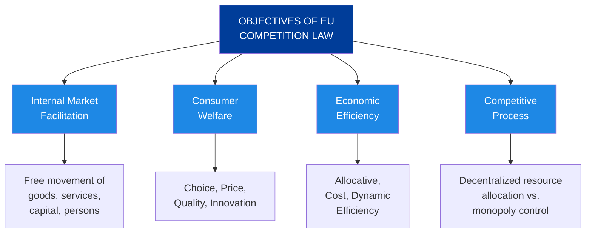

# Module 3: Competition Law – Consolidated Summary

**Module Title:** Data and Regulation of Competition  
**Instructor:** Merve Oner Kabadayi, PhD Researcher at TILT/Tilburg Law School  
**Date:** 23 September 2025

This consolidated document synthesizes the essential concepts from Module 3, integrating the core lecture materials with comprehensive additional readings on competition law, with particular emphasis on **Articles 101 and 102 of the Treaty on the Functioning of the European Union (TFEU)** and their application in the digital economy and data-driven markets.

---

## Table of Contents

1. [Introduction: Competition Law in Context](#introduction)
2. [Objectives and Foundations of EU Competition Law](#objectives)
3. [Articles 101 and 102 TFEU: Core Provisions](#articles-101-102)
4. [Article 101 TFEU: Anti-Competitive Behaviour (Cartel Prohibition)](#article-101)
5. [Article 102 TFEU: Abuse of Dominant Position](#article-102)
6. [Merger Control Under the EUMR](#merger-control)
7. [Data and Competition Law: Emerging Challenges](#data-competition)
8. [Case Studies and Practical Application](#case-studies)
9. [EU vs. US Competition Law](#eu-vs-us)
10. [Key Takeaways](#conclusions)

---

## Introduction: Competition Law in Context {#introduction}

### Historical Background

Competition law emerged in the late 19th and early 20th centuries in response to the concentration of economic power. The **Sherman Act** (1890) in the United States first established that "every contract, combination in the form of trust or otherwise, or conspiracy, in restraint of trade or commerce among the several States" is illegal. This foundational principle aimed to protect competitive markets from being dominated by powerful monopolies controlled by the "Robber Barons" such as John D. Rockefeller, Cornelius Vanderbilt, Andrew Carnegie, and J. P. Morgan.

The European Union later developed its own competition framework, enshrining competition principles in the Treaties and establishing competition as a fundamental component of the internal market project.

### Why Competition Law Matters Today

The digital economy presents unprecedented challenges to traditional competition law frameworks. The shift from the **Oil & Gas Era** (where 2005 market leaders like Exxon and GE dominated) to the **Big Tech Era** (where 2024 market leaders include Microsoft, Apple, Amazon, Alphabet, and Meta) illustrates the transformation of value creation from tangible assets to intangible data and digital platforms.

**Key Transformations:**
- Data is now considered the "new oil" and the world's most valuable resource
- Data generation: ~2.5 quintillion bytes daily (Forbes)
- Data is the new currency of the digital economy
- Tech giants accumulate overwhelming advantages through data accumulation

**The Central Question:** Can & should EU competition law address the dominant positions of tech giants built primarily through data accumulation?

### Competition Law's Scope

Competition law concerns itself with five critical parameters:
1. **Price** – Advertisement-dependent "free" services where data is the main currency
2. **Quality** – Privacy concerns elevated as competition concerns
3. **Output** – Data as an asset; monopolization of data
4. **Choice** – Availability of alternative providers
5. **Innovation** – Does competition law facilitate or hinder innovation?

---

## Objectives and Foundations of EU Competition Law {#objectives}

### Legal Basis

EU competition law rests on:

- **Treaty on the Functioning of the European Union (TFEU):** Articles 101–109 define rules applying to undertakings
- **Protocol No. 27 on the Internal Market and Competition:** Clarifies that competition protection is integral to the internal market
- **Article 3 TEU:** Establishes that the EU shall work for a "highly competitive social market economy"

The founding principle is Margrethe Vestager's observation: "There would be **no genuine integration without a Single Market** – and **no functioning Single Market without a strong competition policy enforced by a central competition authority**."

### Primary Objectives of EU Competition Law

**1. Facilitation and Safeguarding of the Internal Market**

The internal market is "an area without internal frontiers in which the free movement of goods, persons, services and capital is ensured." A functioning competitive process is essential to this goal. Competition rules protect "not only the immediate interests of individual competitors or consumers but also the structure of the market and thus competition as such" (*C-8/08 T-Mobile Netherlands BV*).

**2. Protection of Consumer Welfare**

"Our aim is simple: to protect competition in the market as a means of **enhancing consumer welfare** and ensuring an **efficient allocation of resources**" – former Commissioner Neelie Kroes (2005). Consumer welfare encompasses:
- Access to goods and services at competitive prices
- Choice among market alternatives
- Quality and innovation incentives

**3. Economic Efficiency**

Competition law promotes three forms of economic efficiency:
- **Allocative Efficiency:** Resources directed to their most valued uses
- **Cost Efficiency:** Companies minimizing production costs
- **Dynamic (Innovative) Efficiency:** Incentives for continuous innovation and long-term economic growth

**4. Protection of the Competitive Process**

Competition as a discovery procedure (Friedrich A. von Hayek) allows markets to allocate resources dynamically through autonomous decisions by market participants rather than through central planning or dominant player control.



---

## Articles 101 and 102 TFEU: Core Provisions {#articles-101-102}

### Overview of the Two Pillars

EU competition law rests on two fundamental prohibitions that form the backbone of antitrust enforcement:

| Provision | Focus | Type of Violation | Legal Test |
|-----------|-------|------------------|-----------|
| **Article 101 TFEU** | Anti-competitive agreements, decisions, concerted practices | Horizontal/vertical collusion, cartels | Between undertakings + effect on trade + effect on competition |
| **Article 102 TFEU** | Abuse of dominant position | Monopoly abuse, exploitative/exclusionary conduct | Dominant position + abuse + effect on trade |

Both provisions are essential tools:
- **Article 101** prevents companies from colluding to reduce competition
- **Article 102** prevents dominant companies from using their power to further restrict competition

---

## Article 101 TFEU: Anti-Competitive Behaviour {#article-101}

### The Provision

**Article 101 TFEU** (ex Article 81 TEC):

> The following shall be prohibited as incompatible with the internal market: all **agreements** between **undertakings**, **decisions by associations of undertakings** and **concerted practices** which may **affect trade between Member States** and which have as their **object or effect** the **prevention, restriction or distortion of competition** within the internal market, and in particular those which:
> 
> (a) directly or indirectly fix purchase or selling prices or any other trading conditions;
> (b) limit or control production, markets, technical development, or investment;
> (c) share markets or sources of supply;
> (d) apply dissimilar conditions to equivalent transactions with other trading parties, thereby placing them at a competitive disadvantage;
> (e) make the conclusion of contracts subject to acceptance by the other parties of supplementary obligations which, by their nature or according to commercial usage, have no connection with the subject of such contracts.

This article applies to all conduct that restricts competition through coordination between independent market participants.

### Legal Test for Article 101 TFEU Violation

A violation of Article 101(1) requires establishing five elements:

#### 1) Between Undertakings

An **undertaking** is any entity engaged in economic or commercial activities, regardless of:
- Whether activities are carried out for profit
- Legal form (company, partnership, individual trader, public body engaged in commercial activity)
- Sector (manufacturing, services, public utilities)

**Examples:** Microsoft, Facebook, Google, telecommunications providers, hospitals offering paid services.

**Exclusion:** Purely personal or household activities do not constitute economic activities.

#### 2) Agreements or Concerted Practices

Article 101 captures two distinct forms of coordination:

##### a) **Agreements**

An agreement is any arrangement where parties determine how they will behave on the market. Key characteristics:
- **No formal document required:** Oral agreements suffice (phone calls, emails, "handshake deals")
- **Intent immaterial:** Parties need not intend to restrict competition; effect is what matters
- **No meeting necessary:** Communication can occur indirectly or through intermediaries

**Types of Agreements:**

**Horizontal Agreements (Between Competitors at Same Supply Level)**
- Price fixing (most serious: "hard-core cartel")
- Market sharing
- Bid rigging
- Information exchange at competitors' level
- Production quotas
- Technology pools

*Example:* Spotify and Apple Music agreeing to charge the same subscription price to consumers.

**Vertical Agreements (Between Undertakings at Different Supply Levels)**
- Resale price maintenance (fixing retail prices)
- Exclusive distribution arrangements
- Territorial restrictions
- Selective distribution systems
- Tied selling (tying one product to purchase of another)

*Example:* A manufacturer fixing the retail price at which a distributor may sell its products.

**The Principle:** "Competitors know each other so well, even a wink and a nod between them could lead to anti-competitive behaviour."

##### b) **Concerted Practices**

A concerted practice is informal coordination where undertakings:
- Knowingly coordinate their behavior
- Substitute practical cooperation for the risks of competition
- Do NOT have a formal agreement or decision

**Key Distinction:** Evidence of direct agreement is not required. It suffices that parties reveal their strategies to each other such that each knows the other's intended conduct.

**Test (from CJEU Case Law):**
- Parties coordinate behavior
- Each party is aware of the other's conduct
- This conduct influences each party's own behavior
- Practical cooperation is substituted for independent competition

*Example:* Two airlines independently adjusting prices in parallel based on competitor's price signals transmitted through reservation systems.

#### 3) Effect on Trade Between Member States

The agreement/practice must **affect trade between at least two Member States**. The threshold is low:

- Effect can be **direct or indirect**
- Effect can be **actual or potential**
- Effect can be **minimal** in absolute terms

**NOT Required:**
- Trade must cross borders
- Effect must increase trade volumes
- Parties must be in different Member States

**Standard:** If the pattern of trade between at least two Member States is likely to be impacted (even modestly), the requirement is met.

**Presumption:** If an agreement covers several EU Member States or a substantial part of one Member State, effect on inter-state trade is presumed.

#### 4) Effect on Competition: "By Object" or "By Effect"

The restriction must affect competition through one of two pathways:

##### a) **Restriction By Object**

Certain conduct is **inherently restrictive** of competition and requires no analysis of actual effects. These are known as **"hard-core cartels"**:

**Per Se Violations (No Effects Analysis Required):**
1. **Price Fixing** – Directly or indirectly fixing prices
2. **Market Sharing** – Allocating customers, territories, or markets
3. **Bid Rigging** – Collusion in tender processes
4. **Production/Sales Limiting** – Quotas or output restrictions

For these practices, competition authorities need not prove actual harm; the conduct's object itself reveals anticompetitive intent.

**Legal Presumption:** If an agreement's object is to restrict competition, it is presumed to have that effect. The burden shifts to parties to prove otherwise.

##### b) **Restriction By Effect**

Conduct is evaluated based on its **actual or likely competitive impact**. This analysis requires:

- Economic analysis of market conditions
- Counterfactual reasoning (what would happen without the agreement?)
- Evaluation of whether agreement prevents, restricts, or distorts competition

**Competitive Harm Indicators:**
- Price increases or price stabilization at higher levels
- Output reduction
- Reduction in innovation
- Reduction in product variety or quality
- Decreased consumer choice

**De Minimis Rule:** If an agreement's effect on competition is insignificant, Article 101(1) does not apply. The Commission Regulation defines thresholds:
- Horizontal agreements: Combined market share < 10%
- Vertical agreements: Market share < 30%

**When Effect is NOT Insignificant:**
- Information exchange among competitors has clear negative effects if frequent, current, and individualised

#### 5) No Objective Justification Under Article 101(3) TFEU

**Article 101(3) Exemption:**

Even if an agreement violates Article 101(1), it may be exempted if it satisfies all four conditions:

```
An agreement which restricts competition may be declared compatible if:

1) It contributes to improving the production or distribution of goods or 
   technical or economic progress;

2) It allows consumers a fair share of the resulting benefits;

3) It does not impose restrictions beyond those indispensable to achieve 
   these objectives; AND

4) It does not eliminate competition for a substantial part of the products 
   concerned.
```

**Key Points:**

- **All four conditions must be satisfied.** Failure in any one element means no exemption.
- **Burden of Proof:** Parties claiming exemption bear the burden of proving all four conditions.
- **No Automatic Exemption:** Exemptions were historically granted on a case-by-case basis, but now typically covered by **Block Exemption Regulations** for certain agreement categories (e.g., vertical agreements, technology transfer agreements, horizontal cooperation agreements).

**Balancing Test:**
The exemption performs a **balancing test**: Do the efficiency benefits to consumers outweigh the competitive restrictions? If yes, the agreement serves pro-competitive purposes and merits exemption.

### Horizontal Block Exemption Regulations

The Commission has issued **Block Exemption Regulations** for categories of agreements presumed to satisfy Article 101(3):

1. **Horizontal Cooperation Agreements:** R&D agreements, production agreements, purchasing agreements, marketing agreements, standardization agreements
2. **Vertical Agreements:** Distribution agreements, exclusive distribution, selective distribution (max 30% market share threshold)
3. **Technology Transfer Agreements:** Patent licenses, know-how licenses, software licenses (max 30% market share threshold)

### Enforcement: Fines and Remedies

**Administrative Penalties (Article 23 TFEU):**
- **Up to 10% of annual worldwide turnover** of the company
- Applied to both participating companies in an agreement
- Can exceed €1 billion for major cartels

**Example Fines:**
- **Google (2018):** €4.342 billion for abusing dominant position in search
- **Truck Cartel (2016):** €3.8 billion
- **Google (2025):** €2.95 billion
- **Google Shopping (2017):** €2.42 billion

**Private Enforcement:**
- Injured parties may sue for damages in national courts
- **Directive 2014/104/EU (Actions for Damages Directive)** facilitates private claims
- Court can award lost profits, price overcharges, and costs

---

## Article 102 TFEU: Abuse of Dominant Position {#article-102}

### The Provision

**Article 102 TFEU** (ex Article 82 TEC):

> Any **abuse** by one or more **undertakings of a dominant position** within the **internal market or in a substantial part of it** shall be prohibited as incompatible with the internal market in so far as it may **affect trade between Member States**.
>
> Such abuse may, in particular, consist in:
>
> (a) directly or indirectly imposing unfair purchase or selling prices or other unfair trading conditions;
> (b) limiting production, markets or technical development to the prejudice of consumers;
> (c) applying dissimilar conditions to equivalent transactions with other trading parties, thereby placing them at a competitive disadvantage;
> (d) making the conclusion of contracts subject to acceptance by the other parties of supplementary obligations which, by their nature or according to commercial usage, have no connection with the subject of such contracts.

Unlike Article 101, which prohibits **coordination between undertakings**, Article 102 addresses **unilateral conduct by a single dominant firm** or joint dominance by multiple firms.

### Legal Test for Article 102 TFEU Violation

A violation of Article 102 requires establishing five elements:

#### 1) Undertaking

Same definition as Article 101: any entity engaged in economic/commercial activities.

#### 2) Dominant Position

**Definition (CJEU):**
> A position of economic strength enjoyed by an undertaking which enables it to **prevent effective competition being maintained on the relevant market** by giving it the power to behave to an **appreciable extent independently of its competitors, customers and ultimately of its consumers**.

**Key Elements:**
- **Economic strength:** The undertaking has substantial market power
- **Independence:** Ability to act without regard to competitors' reactions
- **Prevention of effective competition:** Power to maintain supracompetitive prices, reduce output, or limit innovation

**Assessment:**
- Dominance is evaluated in relation to the **internal market as a whole or a substantial part of it**
- **Single Member State suffices:** Dominance in one EU Member State is sufficient for Article 102 to apply
- Market definition is critical (using SSNIP test – Small but Significant Non-transitory Increase in Price)

**Market Share as Indicator:**
- > 50% market share: Generally indicates dominance (rebuttable presumption)
- 40-50% market share: May indicate dominance depending on context
- < 40% market share: Rarely indicates dominance unless other factors present

**Other Factors:**
- Barriers to entry and expansion
- Financial resources and technological lead
- Vertical integration
- Access to supply and distribution channels
- Network effects and switching costs
- Customer loyalty

#### 3) Abuse

**Definition:** No single definition exists, but abuse is the improper use of dominant position that distorts or restricts competition. Articles 102(a)-(d) provide **non-exhaustive examples** of abusive conduct.

**Distinction:** A dominant position itself is **not illegal**. The TFEU specifically provides that dominance confers upon the undertaking a **special responsibility not to allow its conduct to impair genuine undistorted competition** (*Guidance on Article 82 Enforcement Priorities*, 2009).

**Categories of Abusive Conduct:**

##### a) **Exploitative Abuse**

Conduct that exploits customers or trading partners by imposing **unfair prices or trading conditions**:

**Excessive Pricing (Article 102(a)):**
- Imposing prices that have no reasonable relationship to the economic value provided
- *Example:* Charging excessive pharmaceutical prices for life-saving drugs with no close substitutes

**Unfair Trading Conditions (Article 102(a), (d)):**
- Imposing payment terms, delivery conditions, or other terms that are grossly disadvantageous
- Bundling products in ways that exploit consumers
- *Example:* Forcing retailers to stock slow-moving products to access fast-moving products

**Price Discrimination (Article 102(c)):**
- Applying dissimilar conditions to equivalent transactions with different trading parties
- *Requirement:* Transactions must be **equivalent** (similar products, similar volumes, similar timing)
- *Exception:* Objective justification (e.g., cost differences, market conditions)
- *Example:* Charging the same supplier different prices for identical products based solely on buyer identity

##### b) **Exclusionary Abuse**

Conduct that forecloses market access for **competitors** or prevents their competition:

**Predatory Pricing:**
- Setting prices below costs to eliminate or discipline competitors
- *Condition:* Reasonable expectation of recouping losses through supracompetitive pricing post-exit
- *Example:* Microsoft pricing its browser below cost to eliminate Netscape

**Refusal to Deal:**
- Refusing to supply an essential input to competitors
- *Requirements* ("Exceptional Circumstances Test" from *Magill* and *IMS Health*):
  1. The input is **indispensable** for downstream competition (no substitute)
  2. Refusal **excludes all effective competition** on the downstream market
  3. Refusal **prevents emergence of a new product** for which consumer demand exists
  4. Refusal is **objectively unjustified**
- *Example:* **Microsoft** refusing to disclose interface information to competitors wanting to develop interoperable software

**Predatory Exclusion:**
- Pricing strategies, exclusive dealing, or other conduct designed to foreclose competitors
- *Analysis:* Would an equally efficient competitor be able to compete?
- *Standard:* "As Efficient Competitor Test" – would a competitor as efficient as the dominant firm be forced to exit or unable to enter?
- *Example:* Tying or bundling to foreclose access to markets

**Exclusive Dealing:**
- Requiring customers to purchase exclusively from the dominant firm
- Preventing customers from dealing with competitors
- *Example:* Long-term exclusive contracts foreclosing alternatives
- *Countervailing Factors:* Efficiency gains, pro-competitive justifications

**Tying and Bundling:**
- Conditioning sale of one product (the "tying product") on purchase of another product (the "tied product")
- Particularly problematic if leveraging dominance from one market to another
- *Example:* Conditioning Windows licensing on acceptance of Internet Explorer browser
- *Requirements:* Two separate products, dominant position in tying product, coercion, foreclosure effect

**Margin Squeeze:**
- Narrowing the gap between upstream wholesale prices and downstream retail prices
- Forecloses downstream competitors unable to operate profitably at resulting margins
- *Example:* Vertically integrated telecom incumbent raising interconnection charges while reducing retail prices

#### 4) Effect on Trade Between Member States

Same standard as Article 101: trade between at least two Member States must be **potentially or actually** affected. Low threshold, typically presumed for companies with multi-Member State operations.

#### 5) No Objective Justification

Dominant conduct may escape Article 102 liability if objectively justified:

**Possible Justifications:**
1. **Efficiency gains:** Conduct generates substantial offsetting pro-competitive benefits
2. **Consumer benefits:** Conduct benefits consumers overall despite competitive restrictions
3. **Safety/health:** Conduct necessary for safety, health, or consumer protection
4. **Technical feasibility:** Conduct necessary due to technical requirements
5. **Competition on merits:** Conduct results from superior performance, not anticompetitive tactics

**Burden:** Dominant firm must prove justification. Efficiency claims must be substantiated with concrete evidence.

### Special Responsibility of Dominant Undertakings

A critical principle undergirds Article 102: **Dominant undertakings have a special responsibility to ensure their conduct does not distort competition.**

This means:
- Conduct lawful for non-dominant firms may be abusive for dominant firms
- Higher behavioral standards apply
- Stricter scrutiny of contractual arrangements and pricing practices

### Digital Markets Act: Complementary Framework

The **Digital Markets Act (DMA)**, which became operative in 2024, supplements Article 102 by imposing **ex-ante (preventive) obligations** on designated "gatekeeper" online platforms. Unlike Article 102 (which requires proving abuse after the fact), the DMA prohibits specified conduct prospectively for platforms meeting designation criteria (size, control of digital services, strategic importance).

---

## Merger Control Under the EUMR {#merger-control}

### Legal Framework

**Regulation (EC) No 139/2004 on the Control of Concentrations (EUMR)** provides a separate competition tool: **preventive merger control**. Unlike Articles 101-102, which apply to post-merger conduct, merger control assesses concentration **before it occurs**.

### Rationale for Merger Control

Mergers can reduce competition in several ways:
- **Horizontal mergers:** Eliminate a competitor, reduce market participants
- **Vertical mergers:** Create foreclosure opportunities (access denial)
- **Conglomerate mergers:** Enable leveraging of dominance across markets

Merger control is a **prophylactic tool**: problems are prevented rather than remedied after harm occurs.

### Legal Test for Incompatible Merger

**Article 2(3) EUMR:**

> A concentration which would **significantly impede effective competition** (SIEC) in the **common market** or in a **substantial part** of it, in particular as a result of the creation or strengthening of a dominant position, shall be declared **incompatible with the common market**.

### Elements of the SIEC Test

#### 1) Concentration

A **concentration** occurs when:

**a) Merger:** Two previously independent undertakings become one
- *Example:* Facebook acquires WhatsApp, combining two independent social media platforms

**b) Acquisition of Control:** One undertaking gains control over another
- *Example:* Microsoft acquires 55% of Netflix shares
- **Control:** Power to exercise decisive influence on an undertaking's operations

**NOT a Concentration:**
- Temporary shareholding for investment purposes only
- Transactions between companies already under common control (e.g., parent company reorganizations)

#### 2) EU Dimension

The merger must meet jurisdictional thresholds. **Primary Thresholds (Article 1(2)):**

**General Thresholds:**
- **Combined worldwide turnover > €5,000 million** AND
- **EU-wide turnover of at least two undertakings > €250 million each**

**Alternative Threshold:**
- **EU-wide turnover of at least three undertakings > €100 million each** AND
- **At least two of these with turnover > €30 million in same Member State** AND
- **Each of at least two undertakings > €25 million worldwide**

**German Amendment (§ 35 (1a) ARC, 2017):**
- **Transaction value > €400 million** (even if turnover thresholds not met)
- Responds to concerns about free services (zero turnover but high value)

**Referral Rules:**
- Concentration can be referred from Member States to Commission if competent
- Commission can refer back to Member States (Article 4(5), Article 9)

#### 3) Significantly Impede Effective Competition (SIEC Test)

The merger must be assessed as likely to **significantly impede competition** (standard: lower than outright prohibition, higher than trivial effect).

**Analysis Methods:**

**a) Non-Coordinated Effects:**
- Risk of **unilateral price increases** due to loss of competitive constraint
- Merger creates incentive and ability to raise prices post-merger
- Competitors cannot compensate for lost competitor
- *Example:* Removal of significant price competitor → remaining firms raise prices

**b) Coordinated Effects:**
- Merger makes **coordination easier** among remaining competitors
- Post-merger market structure facilitates collusion (fewer, more symmetric players)
- *Example:* Merger of two of five competitors → remaining three can more easily coordinate prices

**c) Foreclosure Effects (Vertical/Conglomerate Mergers):**
- Merged firm can deny competitors access to essential inputs
- *Example:* Upstream firm acquired by downstream rival → input unavailable to other downstream competitors

**d) Conglomerate Merger Leverage:**
- Dominant position in one market leveraged to adjacent market
- *Example:* Dominant software company acquiring hardware distributor → leverages software dominance to hardware sales

#### 4) Substantial Part of the Internal Market

**Geographic Market Definition:**
- Merger must affect EU internal market as a whole or a "substantial part"
- **One Member State suffices** to meet threshold
- Market definition uses SSNIP test (similar to antitrust cases)

#### 5) Prior Notification

**Procedural Requirement:**
- Parties must notify merger **before closing the transaction**
- Failure to notify can result in dissolution orders and fines

### Data in Merger Control

Data mergers present novel challenges because:

**Quantification Issues:**
- Turnover thresholds become irrelevant for data-dependent companies (Facebook/WhatsApp: $19 billion paid for company with minimal revenue)
- Valuation of data assets difficult
- Market share calculation problematic for "free" services

**Data Concentration Concerns:**
- Merger may combine datasets, reducing market access for competitors
- Lock-in effects increase when data becomes more comprehensive
- Network effects amplified by combined datasets

### Key Merger Cases Involving Data

#### Microsoft/Skype (2011)

**Facts:** Microsoft acquired Skype (video calling service) for €7.5 billion.

**Commission Concerns:**
- Combined market position in consumer communications
- Potential to integrate Skype with Outlook/Windows ecosystem
- Network effects could create tipping

**Resolution:** Cleared without conditions.

**Reasoning:**
- High price sensitivity (services free – customers switch if charged)
- Low market barriers (easy entry for new communication services)
- Dynamic sector with short innovation cycles
- High market share (90% in video calls) not determinative due to market dynamism

**Lesson:** Commission discounts static market share analysis in dynamic digital markets.

#### Facebook/WhatsApp (2014)

**Facts:** Facebook acquired WhatsApp for **$19 billion** – extraordinary price for company with minimal revenue.

**Jurisdictional Challenge:**
- Traditional turnover thresholds not met
- Invoked **Article 4(5) EUMR**: referral by three Member States
- Exceptional procedure to establish jurisdiction

**Commission Concerns:**
- **Data concentration:** Combining Facebook's and WhatsApp's user data
- Facebook's extensive user profiling + WhatsApp's communication data
- Enhanced advertising targeting capability

**Resolution:** Cleared without conditions.

**Reasoning:**
- WhatsApp collected minimal personal data at time of merger
- Large amount of competing ad-targeting data available outside Facebook
- Data portability rights under future GDPR would enable switching
- Privacy concerns fall within **GDPR jurisdiction, not competition law**

**Post-Merger Enforcement:**
- Commission fined Facebook €110 million (2017) for **misleading information** in merger notification
- Facebook had claimed user matching between platforms was "impossible or unreliable"
- Actually, integration was easily feasible

**Lessons:**
- Data concentration itself not automatically problematic under traditional test
- Novel issue of data valuation in M&A pricing unresolved
- Privacy/GDPR considerations distinct from competition concerns (though now recognized as interconnected)

#### Microsoft/LinkedIn (2016)

**Facts:** Microsoft acquired LinkedIn for **$26 billion** (largest tech acquisition by price).

**Jurisdictional Issue:**
- More easily met traditional thresholds given Microsoft's size
- Turnover-based jurisdiction less problematic for Microsoft

**Commission Concerns:**

**1. Professional Social Network Market:**
- LinkedIn dominant in professional networking
- Microsoft could leverage Windows/Office integration
- Pre-installation on Windows and integration with Outlook
- Network effects could tip market

**2. CRM Software Market:**
- LinkedIn data valuable for machine learning in CRM tools
- Microsoft could deny competitors access to full LinkedIn dataset
- Competitors could be hampered in developing competing CRM solutions

**3. Online Advertising Market:**
- Combined Microsoft-LinkedIn data valuable for ad targeting
- Microsoft could increase advertising market power

**Commission Decision: **Cleared with Commitments** (Article 8(2) EUMR)

**Imposed Commitments:**
1. No pre-installation of LinkedIn on Windows PCs
2. Maintain API interoperability with Microsoft Office
3. Continued access to LinkedIn data for third-party CRM competitors
4. Interoperability commitments for Outlook calendar/contact data

**Lesson:** Commitments can resolve data-driven merger concerns; not all data mergers prohibited.

#### Google/Fitbit (2020)

**Facts:** Google acquired Fitbit (wearable health data company) for ~$2.1 billion.

**Concerns:**
- Health/fitness data concentration with Google
- Google's vast user profiling + health data integration
- Potential for health insurance discrimination, targeted advertising

**Resolution:** Cleared with commitment to data silo.

**Key Commitment:** 
- Google committed to **data silo**: health data from Fitbit will not be combined with Google's advertising profile data
- Separation enforced through technical and organizational measures
- Monitoring provisions

**Lesson:** Data silos can address competition concerns in health/sensitive data contexts.

### State Aid

**Article 107-109 TFEU** address **State aid** (subsidies to undertakings). State aid distorts competition by enabling undertakings to compete using public funds rather than merit.

**General Prohibition (Article 107(1)):**
Aid granted by Member States that distorts or threatens to distort competition and affects inter-state trade is prohibited.

**Exceptions:** Certain aid may be justified for public interest purposes (regional development, environmental protection, etc.).

---

## Data and Competition Law: Emerging Challenges {#data-competition}

### Why Data Is a Topic for Competition Law

Data has become a critical asset affecting market power and competitive dynamics. Competition authorities must account for data as they assess:
- **Market power:** Does control of data create market dominance?
- **Market foreclosure:** Can dominant firms deny competitors access to essential data?
- **Merger effects:** Does combination of datasets significantly impede competition?
- **Innovation:** Do data-driven network effects reduce incentives for competitive innovation?

### Microsoft Case: Data as Essential Facility

**Microsoft (COMP/C-3/37.792, 2004)** remains foundational for data in competition law.

**Facts:**
- Microsoft dominant in computer operating systems (Windows)
- Competitors wanting to develop interoperable software needed **interface information** (data about how Windows operates)
- Microsoft withheld this data or discriminated through pricing
- Competitors unable to offer products compatible with Windows

**Commission Finding:**
- Interface information was **essential facility** for secondary software market competition
- Refusal to disclose constituted **abuse of dominant position** (Article 102)
- Dominance in OS market leveraged to block competition in software market

**Significance for Data:**
- Established that **refusal to disclose data** can constitute Article 102 abuse
- Demonstrated data's importance as competitive input
- Set standards for when access obligations arise ("exceptional circumstances")

**Remedy:**
- Microsoft ordered to disclose interface information
- License on **RAND terms** (Reasonable And Non-Discriminatory)
- Fine of €497 million

### Paradigm Shifts in Digital Economy

Data challenges traditional competition law concepts in fundamental ways:

#### 1) Quantification Issues

**Problem:** Competition law depends on precise quantification (prices, market shares, turnovers) but data value resists quantification.

**SSNIP Test Failure:**
- Test asks: Would customers switch from Product A to Product B if price increased 5-10%?
- For free services (Google Search, Facebook): **What is the price?**
- How to measure effect of price increase on zero-priced service?

**Market Share Issues:**
- Market share calculated on sales basis
- Free services have zero revenue (data collected in exchange)
- How to calculate market share of "free" service?

**Transaction Value Problem:**
- Facebook paid $19 billion for WhatsApp with minimal revenue
- Price reflects data value, not current sales
- Traditional turnover thresholds miss high-value acquisitions

**German Response (2017):**
- Amended merger control thresholds to include transaction value ($400 million) even if turnover not met
- Directly addresses free service valuations

#### 2) Multi-Sided Markets and Network Effects

**Definition:** Platforms matching supply and demand across multiple "sides" (e.g., Uber: drivers + riders, Facebook: users + advertisers).

**Network Effects:**
- **Direct network effects:** More users of platform = more valuable for all users (WhatsApp)
- **Indirect network effects:** More users on one side = more valuable for other side (Airbnb)

**Tipping:**
- Network effects can cause markets to "tip" toward single winner
- Once one platform dominates, competitors cannot attract users ("the winner takes it all")
- Peter Thiel: "Competition is for losers" – reflects Silicon Valley strategy to monopolize markets

**Competitive Implications:**
- Once market tips, effective competition ceases
- Locked-in users generate switching costs
- Data accumulation feeds network effects (more data = better recommendations = more valuable platform)

**Countervailing Factors:**
- **Multi-homing:** Users can maintain profiles on multiple platforms (dating apps)
- **Data portability:** GDPR Article 20 enables users to transfer personal data to competitors
- **Interoperability:** Platform access for third-party developers

#### 3) Loss of Customer Interface

**Problem:** Traditional markets connect supplier directly with customer. In digital markets, platforms control access.

**Gatekeeping:**
- Platform operator sits between supplier and customer
- Controls terms of access, data visibility, pricing visibility
- Can exclude suppliers or discriminate among them

**Implications:**
- Suppliers lose direct market access
- Coordination process disrupted
- Platform has informational advantage (sees all suppliers and customers)
- Market power concentrated at platform layer

**Example:** Amazon Marketplace – sellers dependent on Amazon for access to customers.

#### 4) Algorithms and AI

**Problem:** As machines increasingly make pricing and supply decisions through algorithms, traditional cartel enforcement becomes difficult.

**Scenario - Algorithmic Collusion:**
- Two retailers program pricing algorithms to optimize profit
- Algorithms, given prices of competitor, autonomously determine best price response
- Result: Prices stabilize at high levels (cartel-like outcome)
- But no agreement between retailers; merely independent algorithm optimization
- Detection difficult (no email trails, meetings, or communications)

**Legal Issues:**
- Does Article 101 require **intent to restrict competition**?
- Can machines violate Article 101 without human decision?
- How to prove "meeting of minds" if algorithms autonomously coordinate?

**Regulatory Response:**
- Commissioner Vestager's "antitrust compliance by design"
- May require software design that prevents algorithmic collusion
- Emerging focus on **technological approach** to competition enforcement

#### 5) Market Dynamics and Disruption

**Debate:** Are digital markets self-regulating, or do they require intervention?

**"Disruption" Thesis:**
- Markets supposedly dynamic and contestable ("just one click away")
- Yahoo, Myspace, Nokia, Netscape seemed invincible but declined
- New entrants (initially: Google, Facebook, Amazon) disrupted incumbents
- Regulatory intervention may undermine innovation incentives

**"Lock-In" Counter-thesis:**
- GAFAM companies (Google, Apple, Facebook, Amazon, Microsoft) dominated >10 years
- Not replaced by new entrants despite apparent contestability
- Network effects and switching costs create durable positions

**Market-Making Strategies:**
- Acquisition of nascent competitors (e.g., Facebook acquiring Instagram, Snapchat competitors)
- Copy competing features (e.g., Snapchat Stories → Instagram Stories)
- Financial advantages enabling buy-outs of potential disruptors
- Wealth accumulated through past dominance protects future dominance

**Competition Law Implication:**
- Traditional tools (Articles 101-102, Merger Control) may be necessary to maintain contestability
- Market does not "self-correct" if barriers to entry/competition high
- Intervention justified to preserve competitive process, not to micromanage markets

---

## Case Studies and Practical Application {#case-studies}

### Case 1: Commission v Microsoft (Data Exclusion)

**Scenario:** Microsoft dominates corporate PC operating systems. Introduces new Windows version supporting only its Office software, degrading performance of Google Docs and LibreOffice.

**Analysis Under Article 102:**

**Element 1 - Undertaking:** ✓ Microsoft is undertaking engaged in commercial activities.

**Element 2 - Dominant Position:** ✓ Microsoft has >90% market share in corporate PC OS market. Can act independently of competitors.

**Element 3 - Abuse:**
- Exclusionary abuse: Excludes Google Docs and LibreOffice from corporate market
- Leverages dominance in OS to restrict competition in office software market
- Network effects reinforce exclusion (if locked into Office, harder to switch)

**Element 4 - Effect on Trade:** ✓ Affects multiple Member States.

**Element 5 - No Justification:**
- Microsoft claims: Architectural decisions for better performance/security
- Counterargument: Could achieve goals without excluding competitors
- Microsoft could maintain interoperability with competitors
- Exclusion appears designed to strengthen Office market position, not efficiency

**Likely Outcome:** **Violation of Article 102 TFEU**
- Abuse of dominant position through exclusionary conduct
- Remedy: Requirement to maintain interoperability, possible fine (up to 10% worldwide turnover)

**Legal Precedent:** Similar to actual Microsoft case (COMP/C-3/37.792) addressing refusal to disclose interface information.

### Case 2: Apple/Netflix Merger

**Scenario:** Apple proposes acquiring 55% of Netflix. Apple controls App Store, Apple TV+, hardware. Netflix has vast content library.

**Merger Control Analysis Under EUMR:**

**Element 1 - Concentration:** ✓ Acquisition of control (55% shares).

**Element 2 - EU Dimension:** ✓ Both companies have combined worldwide turnover >>€5 billion, EU-wide revenue >>€250 million.

**Element 3 - SIEC Test:**

**Horizontal Effects (Digital Entertainment/Streaming):**
- Both active in video streaming
- Combined market share in streaming substantial
- Combined Netflix content + Apple ecosystem powerful
- Could raise prices or degrade service quality

**Vertical Effects (Hardware-Software Integration):**
- Apple could pre-install Netflix on hardware
- Could integrate Netflix with Apple ecosystem (Siri, recommendations)
- Competitors (Disney+, Amazon Prime) disadvantaged

**Conglomerate Effects (Leveraging):**
- Apple could leverage hardware dominance (iPhones, iPads) to Netflix advantage
- Preferential treatment in App Store

**Element 4 - Substantial Part:** ✓ Affects EU-wide digital entertainment market.

**Likely Outcome (if notified today): **Likely Approved with Conditions**
- Conditional clearance most probable (similar to Microsoft/LinkedIn)
- **Potential Commitments:**
  - No pre-installation of Netflix on Apple devices
  - Continued access to App Store with neutral terms
  - Maintained interoperability with other streaming services
  - No preferential treatment in Siri recommendations
  - Data silo: Netflix data not integrated with Apple user profiling

**Alternative:** Outright prohibition if competitive concerns too severe, or unconditional clearance if efficiencies substantial.

### Case 3: Meta/TikTok Concerted Practice

**Scenario:** Meta executives meet with TikTok executives. They discuss algorithms, user engagement strategies, and advertising pricing models. Later: "Two giants coming together to make more profit."

**Analysis Under Article 101:**

**Element 1 - Between Undertakings:** ✓ Meta and TikTok are separate undertakings engaged in commercial activities.

**Element 2 - Agreement or Concerted Practice:**
- Explicit agreement unclear (no formal contract signed)
- **Concerted Practice** likely established:
  - Parties revealed competitive strategies to each other
  - Each now aware of other's intended pricing and algorithm approaches
  - Practical cooperation substituted for competitive risk
  - Statements ("two giants making more profit") suggest coordination

**Element 3 - Effect on Trade:** ✓ Affects social media/advertising markets across multiple Member States.

**Element 4 - Effect on Competition By Object:**
- If discussing price coordination in advertising: **Hard-core cartel (by object)**
- If discussing user engagement strategies: May be by object if intent to allocate customers
- **By effect analysis:** Likely coordinated pricing → higher advertising rates, reduced choice, less innovation

**Element 5 - No Justification:** None apparent. Coordination to increase profit is not efficiency-promoting.

**Likely Outcome: **Violation of Article 101 TFEU**

**Liability:**
- Both Meta and TikTok liable as participants in concerted practice
- Each faces fine up to 10% worldwide turnover
- Meta: ~$116 billion annual revenue → fine up to $11.6 billion
- TikTok: ~$15 billion annual revenue → fine up to $1.5 billion

**Individual Liability - Junior Data Analyst Observer:**

**Commission Question:** Would mere observation change liability?

**Legal Analysis:**
- **As observer only:** If analyst truly did not participate, not liable
- **BUT:** Analyst's presence may constitute evidence of meeting
- **Potential liability triggers:**
  1. If analyst participated in discussions (voiced support, contributed to strategy)
  2. If analyst's role was to document/report on coordination
  3. If analyst failed to distance themselves publicly from unlawful conduct
  4. If analyst reported back to superiors with knowledge of coordination

**CJEU Precedent (Eturas Case C-74/14):**
- Mere awareness of competitors' conduct insufficient for liability
- Must demonstrate **active participation** or **failure to distance oneself**
- Presumption of innocence requires clear evidence of complicity

**Conclusion:** Analyst likely **not liable** if true observer and no active participation. However, if pressed in Commission interview, analyst should carefully document:
- Exact role at meeting
- Whether any statements made
- Timing of awareness
- Whether raised concerns about legality

---

## EU vs. US Competition Law {#eu-vs-us}

### Comparative Framework

| Aspect | EU | US |
|--------|----|----|
| **Main Objective** | Internal Market integration + Consumer welfare | Consumer Welfare (strictly economic approach) |
| **Enforcement Mechanism** | Administrative system (Commission decides) | Criminal law + civil enforcement |
| **Enforcement Actors** | European Commission (DG Competition) + National Competition Authorities | Department of Justice (DOJ) + Federal Trade Commission (FTC) |
| **Penalties (Antitrust)** | Up to 10% of annual worldwide turnover | Up to $100 million USD per violation or higher based on damages |
| **Legal Standard (Cartels)** | Automatic prohibition (with narrow exemption) | Rule of reason (requires effects analysis) |
| **Legal Standard (Dominance)** | Abuse must be shown (dominance itself legal) | Monopoly + anticompetitive conduct |
| **Merger Thresholds** | Turnover-based (+ transaction value in Germany) | Turnover-based + Hart-Scott-Rodino review |
| **Economic Approach** | More economic approach (post-2000); consumer welfare focus | Chicago School (per se rules for hardcore cartels); evolving |

### Philosophical Differences

**EU Approach: Internal Market + Structural Protection**
- Competition law serves broader goal of market integration
- Concern for market structure itself (not just price effects)
- Structural remedies acceptable (divestiture, interoperability requirements)
- More interventionist in principle

**US Approach: Consumer Welfare + Chicago School**
- Efficiency and consumer welfare paramount
- Less concern for market structure if consumer welfare advanced
- Behavioral remedies preferred; structural remedies disfavored
- Less interventionist; market generally self-correcting

### Application: Google Shopping Case

**EU (Commission 2017):**
- **Violation Found:** Article 102 TFEU abuse of dominance
- **Rationale:** Leveraging search dominance (>90% market share) to Google Shopping market
- Preferential placement of Google Shopping results
- Demotion of competing comparison shopping services
- **Remedies:** Conduct remedies (listing requirements, non-discrimination), fine €2.42 billion
- **Duration:** Investigation 7 years

**US (Similar Conduct, Different Outcome):**
- **2020:** DOJ filed antitrust suit against Google for search/advertising practices
- **2023:** Case still pending; no final decision
- **Likelihood:** Case may succeed on search market concerns, but shopping service integration harder to challenge
- **US judges more skeptical:** Integration of services may constitute lawful innovation
- **Efficiency argument stronger:** Vertical integration of shopping into search arguably benefits consumers (better results)

### Cooperation: EU-US Coordination

Despite differences, EU and US authorities cooperate on multi-jurisdictional cases:

**Cooperation Agreements:**
- Bilateral Cooperation Agreement (1991)
- Positive Comity Agreement (1998)
- Best Practices Document (2011)

**Mechanism:**
- Authorities share confidential information (within limits)
- Coordinate investigation timing
- Coordinate remedies where possible
- May reach different conclusions on same facts if focusing on different markets

**Divergence Examples:**
- **Facebook/WhatsApp:** EU cleared after long review; FTC separately addressed antitrust concerns through separate privacy action
- **Microsoft/LinkedIn:** EU approved with commitments; US authorities did not challenge
- **Google Search:** EU fined for abuse; US cases progress slowly

---

## Key Takeaways {#conclusions}

### Article 101 TFEU: Anti-Competitive Behaviour

1. **Scope:** Prohibits agreements, decisions, and concerted practices between independent undertakings that restrict competition and affect inter-state trade.

2. **Hard-Core Cartels:** Price fixing, market sharing, bid rigging are per se violations (by object) requiring no effects analysis.

3. **Legal Test:**
   - Between undertakings
   - Agreement/concerted practice
   - Effect on trade between Member States
   - Effect on competition (by object or effect)
   - No valid Article 101(3) exemption

4. **Enforcement:** Fines up to 10% worldwide turnover; private damages actions possible.

5. **Digital Economy Challenges:**
   - Algorithmic coordination difficult to detect
   - Information exchange among competitors increasingly scrutinized
   - Data pools may facilitate collusion or pro-competitive cooperation

### Article 102 TFEU: Abuse of Dominant Position

1. **Scope:** Prohibits unilateral conduct by dominant undertakings that abuses their power.

2. **Special Responsibility:** Dominant firms held to higher behavioral standards; conduct lawful for non-dominant competitors may be abusive.

3. **Legal Test:**
   - Undertaking
   - Dominant position (economic strength enabling independent behavior)
   - Abuse (exclusionary or exploitative conduct)
   - Effect on trade between Member States
   - No objective justification

4. **Categories of Abuse:**
   - **Exploitative:** Excessive prices, unfair terms, discrimination
   - **Exclusionary:** Refusal to deal, predatory pricing, tying, leveraging

5. **Data-Specific Applications:**
   - Refusal to disclose essential data (Microsoft interface information)
   - Denial of data access to foreclosure competitors
   - Leveraging data dominance across markets

### Merger Control

1. **Tool:** Preventive assessment of proposed concentrations before closing.

2. **Test:** Significantly impede effective competition (SIEC) through creation/strengthening of dominant position.

3. **Data Issues:**
   - Quantification challenges for free services
   - Transaction value thresholds needed (Germany: €400 million)
   - Data concentration may trigger concerns even without price effects
   - Commitments can address competitive concerns (interoperability, data silos)

### Data as Competition Concern

1. **Why Data Matters:** Data is critical competitive input; control of data creates market power; data accumulation feeds network effects.

2. **Essential Facility Doctrine:** Dominant firm cannot refuse access to essential data indispensable for downstream competition (Microsoft precedent).

3. **Multi-Sided Markets:** Network effects from data combinations may create tipping; data portability and interoperability become competitive tools.

4. **Emerging Framework:**
   - Traditional tools (Articles 101-102, Merger Control) applied with adaptations
   - Digital Markets Act adds ex-ante obligations for gatekeepers
   - GDPR intersects with competition (privacy as competitive concern)
   - European Commission emphasizing "more technological approach"

### Practical Enforcement

1. **Commission Enforcement:**
   - Investigatory powers: Inspections, document requests, interviews
   - Decisions imposing fines, conduct remedies, structural remedies
   - Appeals to General Court and Court of Justice

2. **National Authorities:** 
   - Apply EU and national competition law
   - Coordinate through European Competition Network
   - Handle smaller cases, local enforcement

3. **Private Enforcement:**
   - Injured parties sue in national courts for damages
   - Facilitated by Directive 2014/104/EU
   - Growing use for follow-on actions after Commission decisions

### Looking Forward

1. **Digital Market Act:** Complements Articles 101-102 with ex-ante regulation of gatekeepers (non-discrimination, interoperability obligations, data access rights).

2. **Data Access Rights:** Emerging principle that competitors may have right to access essential data, balanced against legitimate data protection and IP interests.

3. **Algorithmic Accountability:** Focus on preventing algorithms from facilitating collusion; "antitrust compliance by design" principle.

4. **Cross-Jurisdictional Coordination:** EU and US increasingly interact; differences in approach require companies to satisfy stricter standard (EU).

---

## Conclusion

Competition law remains fundamental to the functioning of the EU's internal market and protection of consumer welfare. As the digital economy transforms business models and competitive dynamics, Articles 101 and 102 TFEU continue to provide the core legal framework for enforcement, with important adaptations emerging to address data-driven markets, network effects, algorithmic decision-making, and platform gatekeeping.

The tension between **protecting competition as a process** (enabling contestable markets and dynamic innovation) and **intervening to prevent foreclosure/dominance abuses** (protecting consumers from supracompetitive prices and limited choice) remains central to competition law policy. The Digital Markets Act and evolving case law suggest a trajectory toward stronger intervention in digital markets, recognizing that unfettered network effects and data accumulation may require regulatory guardrails to maintain competitive markets.

For businesses, the key takeaway is that competition law applies rigorously to digital platforms and data-driven business models. Companies must:
- Avoid agreements with competitors regarding pricing, output, or market allocation
- Exercise special care with dominant market positions, ensuring conduct does not foreclose competition
- Obtain clearance for significant mergers before closing
- Consider data access and interoperability obligations
- Design compliance programs recognizing algorithmic risks to competition

---

## References

### Primary Sources
- Treaty on the Functioning of the European Union (TFEU), Articles 101-109
- Regulation (EC) No 139/2004 (EC Merger Regulation)
- Digital Markets Act (Regulation (EU) 2022/1925)
- General Data Protection Regulation (GDPR)

### Case Law
- *Microsoft Corp. v. Commission* (COMP/C-3/37.792, 2004)
- *Case C-238/05 Asnef-Equifax* [2006] ECLI:EU:C:2006:734
- *Microsoft/Skype* (Case M.6281)
- *Facebook/WhatsApp* (Case M.7217)
- *Microsoft/LinkedIn* (Case M.8124)
- *Google Shopping* (Case AT.39.740)
- *Case C-74/14 Eturas* [2016] ECLI:EU:C:2016:42

### Secondary Sources
- Podszun, R. & Kreifels, S. "Data and Competition Law" in *Research Handbook in Data Science and Law*
- European Parliament Factsheet on Competition Policy (2024)
- Lecture Materials: "Data and Regulation of Competition" (Merve Oner Kabadayi, TILT, 2025)
- European Commission Guidance on Article 82 Enforcement Priorities (2009)
- European Commission Merger Guidelines

