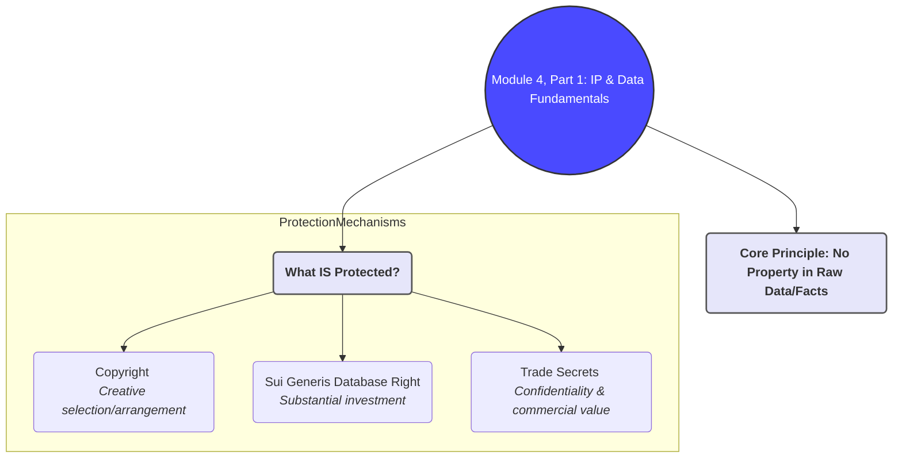
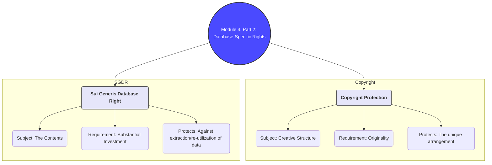
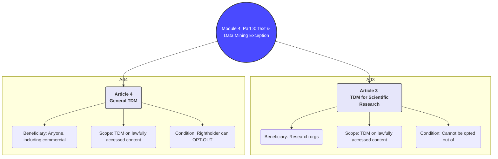
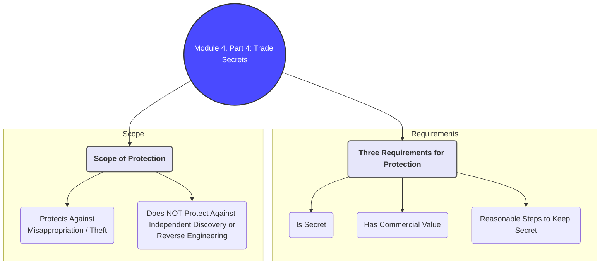

# Brief Summary of Module 4: Intellectual Property and Data

This summary provides a concise overview of the essential concepts from Module 4, drawing from the core lecture (`MENDIS_IP & Data Driven Innovation_Slides.md`) and integrating key ideas from supplementary materials on copyright, data mining, and trade secrets.

## 1. Can Data Be "Owned"? The IP Framework

Intellectual Property (IP) law does not protect raw data or facts themselves. Instead, it protects the *creative expression* or *investment* related to data. This creates a layered system where data can be free, but the databases containing it may be protected.

### Key Principles
- **No Property in Facts**: Raw data (e.g., a temperature reading, a name) is considered a fact and cannot be owned under IP law. This is crucial for the free flow of information.
- **Protection of Expression and Investment**: IP rights apply to:
    1.  **Copyright**: The creative selection and arrangement of data in a database.
    2.  **Sui Generis Database Right**: The substantial investment in obtaining, verifying, or presenting the data.
    3.  **Trade Secrets**: Information kept confidential that has commercial value.

This means that while you can't own the fact "the capital of France is Paris," you might have rights over a creatively structured database of European capitals or a confidential list of customer contacts.
*(Source: `Module_4/MENDIS_IP & Data Driven Innovation_Slides.md`)*

## 2. Copyright and the Sui Generis Database Right

These two rights form the core of database protection in the EU. They can apply simultaneously to the same database.

### Copyright Protection for Databases
- **What it protects**: The "author's own intellectual creation" in the **structure** of the database, not its contents. This refers to the creative selection or arrangement of the materials.
- **Requirement**: Originality. A simple A-Z list would likely not be creative enough to qualify.
- **Scope**: Prevents others from copying the protected structure.

### Sui Generis Database Right (SGDR)
- **What it protects**: The **substantial investment** made by the database creator in obtaining, verifying, or presenting the contents. This right is unique to the EU.
- **Requirement**: A "qualitatively and/or quantitatively substantial investment." This is a financial or resource-based test.
- **Scope**: A very strong right that prevents the extraction and/or re-utilization of a substantial part of the database's contents, even if the data itself is not original. This right is designed to incentivize the creation of databases.

*(Source: `Module_4/MENDIS_IP & Data Driven Innovation_Slides.md`, `Module_4/KLI-Blog-Article (2).md`)*

## 3. Text and Data Mining (TDM) Exception

The rise of AI and data analytics depends on the ability to "mine" large datasets for patterns and insights. This created a conflict with copyright and database rights. The EU's Copyright in the Digital Single Market (CDSM) Directive introduced a crucial exception for Text and Data Mining (TDM).

### What is TDM?
Any automated analytical technique aimed at analyzing text and data in digital form in order to generate information such as patterns, trends and correlations.

### The TDM Exceptions
The CDSM Directive created two mandatory exceptions:
1.  **Article 3: TDM for Scientific Research**:
    - **Who**: Research organizations and cultural heritage institutions.
    - **What**: Allows them to perform TDM on any content they have lawful access to.
    - **Condition**: The right cannot be overridden by contract. This is a very strong exception to support public interest research.

2.  **Article 4: General TDM Exception**:
    - **Who**: Anyone (including commercial entities).
    - **What**: Allows TDM on any content to which they have lawful access.
    - **Condition**: This right **can be reserved** by the rightholder (e.g., through a `robots.txt` file or terms and conditions). This is known as the "opt-out" provision. If the right is not expressly reserved, TDM is permitted.

This framework attempts to balance the interests of rightholders with the needs of researchers and the data-driven economy.
*(Source: `Module_4/MENDIS_IP & Data Driven Innovation_Slides.md`, `Module_4/Data Mining Under the Directive on Copyright and Related Rights in the Digital Single Market.md`)*

## 4. Trade Secrets as Data Protection

When data cannot be protected by copyright or database rights, trade secret law offers an alternative. It does not create a true "property" right but protects against misappropriation.

### Requirements for a Trade Secret
To qualify for protection under the EU Trade Secrets Directive, information must meet three criteria:
1.  **It is secret**: Not generally known or readily accessible.
2.  **It has commercial value because it is secret**: The secrecy gives the holder a competitive edge.
3.  **Reasonable steps have been taken to keep it secret**: The holder must actively protect the information (e.g., through NDAs, access controls, security measures).

### Scope of Protection
- **What it protects against**: Unlawful acquisition, use, or disclosure of the secret information (e.g., industrial espionage, breach of an NDA).
- **What it does NOT protect against**:
    - **Independent discovery or creation**: If someone else develops the same information on their own, it is not a violation.
    - **Reverse engineering**: Analyzing a publicly available product to figure out its secrets is generally lawful.

Trade secrets are a flexible tool for protecting valuable data like algorithms, customer lists, and business strategies, but the protection is lost if the information becomes public.
*(Source: `Module_4/MENDIS_IP & Data Driven Innovation_Slides.md`, `Module_4/KLI-Blog-Article (3).md`)*

