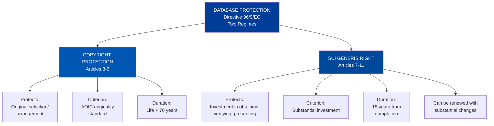
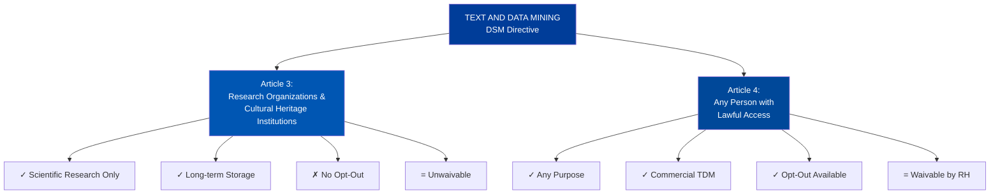
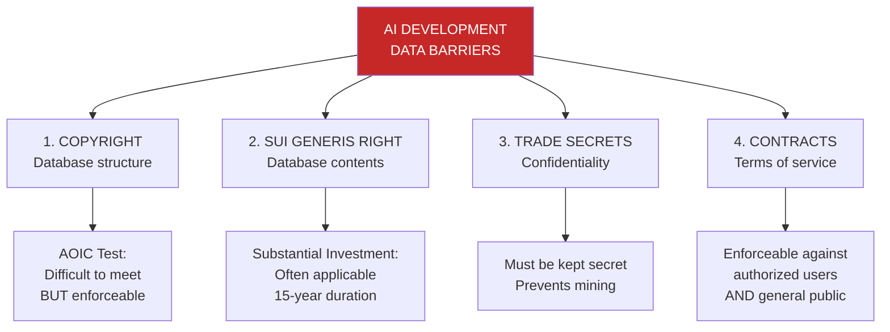

# Module 4: Intellectual Property Law & Database Protection – Consolidated Summary

**Module Title:** Intellectual Property Law & Database Protection  
**Instructor:** Dr. Sunimal Mendis, Assistant Professor in Intellectual Property Law, Tilburg University, TILT  
**Date:** 07/10/2025

This consolidated document synthesizes the essential concepts from Module 4, integrating comprehensive coverage of database protection regimes, text and data mining exceptions, and the critical EU legal frameworks governing data use in the digital economy. It combines theoretical foundations with practical implications for artificial intelligence development and data-driven innovation.

---

## Table of Contents

1. [Introduction: Data and IP Law](#introduction)
2. [Foundational Concepts: Data, Information, and IP Protection](#foundations)
3. [The EU Database Directive: Two-Regime Protection](#database-directive)
4. [Copyright Protection of Databases](#copyright-protection)
5. [Sui Generis Database Rights](#sui-generis-right)
6. [Machine-Generated Databases](#machine-generated)
7. [Text and Data Mining (TDM) Under the DSM Directive](#tdm-exceptions)
8. [Contract Law as a Barrier to Data Mining](#contract-law)
9. [Implications for AI and Data-Driven Innovation](#ai-implications)
10. [Key Takeaways and Recommendations](#conclusions)

---

## Introduction: Data and IP Law {#introduction}

### The Central Question

**Does EU IP law allow data mining of non-personal data contained in a database that has been made available to the public?**

This deceptively simple question underlies complex legal, economic, and ethical tensions in contemporary European law. The answer requires navigation through multiple legal regimes, each with different scopes, requirements, and exceptions.

The question is critical for multiple interconnected reasons. Data serves as the raw material for artificial intelligence, and algorithms require enormous volumes of data to train effectively. Start-ups and small or medium-sized enterprises lack the resources to generate equivalent datasets independently, creating a genuine need for data access. Simultaneously, the European Union aims to foster innovation through its Digital Single Market policies, which explicitly prioritize data-driven innovation. Yet this objective must be balanced against the legitimate interests of database creators who have invested considerable resources in data collection and organization and deserve compensation for their efforts. Beyond these economic considerations, there exists a broader public interest in information access, as freedom of information and knowledge dissemination underpin democratic societies and individual development.

### The Fundamental Misconception: "Available ≠ Free to Use"

A critical misunderstanding pervades contemporary data practices: the belief that publicly accessible data can be freely exploited. This conflates five distinct legal and ethical frameworks that operate independently and simultaneously.

Intellectual property law provides the first layer of protection. Data remain protected by copyright and database rights even when publicly visible. A publicly searchable database does not mean the data within it are in the public domain. Copyright law protects databases that demonstrate originality in their selection and arrangement, and the *sui generis* database right extends to protect compilations regardless of originality, provided substantial investment was made in their creation or verification.

Data protection law, particularly the General Data Protection Regulation, provides a second framework. Personal data remain protected even when publicly visible online. Individuals retain fundamental rights over their personal information regardless of whether they posted it on social media or otherwise made it publicly accessible. The right to data protection cannot be waived by publication, and collection of personal data triggers detailed legal obligations on the collector.

Web scraping law under the DSM Directive creates a third framework, though it is more permissive than the first two. The EU Copyright in the Digital Single Market Directive provides limited exceptions to copyright restrictions for text and data mining, but these exceptions contain critical limitations. The exceptions apply only to lawfully accessed content, and right holders can opt-out through machine-readable signals such as robots.txt files. For research organizations, opt-out is not permitted and the exception is mandatory, but for commercial users, the ability to opt-out significantly limits text and data mining freedoms and reduces the practical utility of this exception.

Contract law functions as a fourth framework. Website Terms of Service constitute binding contracts in EU law, and terms prohibiting automated access or data extraction create legal obligations enforceable against users. The landmark *Ryanair v. PR Aviation* case established a particularly important principle: contractual restrictions on scraping even unprotected databases are enforceable, meaning right holders can create contractual protection more extensive than intellectual property law itself permits.

Beyond legal requirements, ethical frameworks establish a fifth dimension. Using data without consent, transparency, or legitimate purpose violates human autonomy and dignity. International frameworks including the EU's High-Level Expert Group Guidelines on AI and the UNESCO Recommendation on AI Ethics emphasize respect for persons and prevention of harm, establishing normative expectations that extend beyond what law formally requires.

---

## Foundational Concepts: Data, Information, and IP Protection {#foundations}

### Distinguishing Data from Information

The Database Directive protects not individual data points but rather compilations—specifically the selection and arrangement of data. Understanding this fundamental distinction is essential to comprehending the entire framework of database protection.

Raw data consists of unrefined, unorganized symbols such as numbers, text, or images that do not inherently carry specific meaning unless they are processed, organized, and structured within a specific context. Individual units of such raw data are generally not protected under intellectual property law because they do not typically qualify as products of human intellect. A single customer name, address, or phone number has no inherent intellectual property protection, and data in isolation are considered common goods that cannot be appropriated.

Information, by contrast, consists of data that has been processed, organized, and structured within a specific context in order to enable analysis and knowledge acquisition. Information and informational goods can be protected under intellectual property rights when human intellectual effort has been invested in their production. Two principal protections apply: trade secrets protect arrangements of data under the Trade Secrets Directive of 2016, and databases protect collections of data under the Database Directive of 1996.

This distinction proves critical for understanding database protection. The law does not protect the individual facts or data points themselves but rather the human creativity, effort, or investment reflected in how those data are selected, arranged, organized, or verified. This means that the same data could potentially be reused if reorganized or presented in a sufficiently different manner, as the protection extends to the database as a compilation rather than to the data as such.

### Criteria for IP Protection

Three foundational requirements must be met for intellectual property protection to attach to any subject matter. First, the subject matter must qualify as a protectable form, such as a literary work, database, or invention that can potentially receive protection. Second, the specific conditions for that particular form of protection must be fulfilled—originality for copyright, novelty and non-obviousness for patents, distinctiveness for trademarks, and so forth. Third, the rights must be properly exercised through appropriate assignment, licensing, or attribution procedures.

These requirements operate together to ensure that intellectual property protection applies only where both the subject matter is appropriate and the legal requirements have been satisfied. This prevents over-protection while ensuring legitimate protectable interests receive legal recognition.

### What Can Be Protected Under IP Law?

Only products of human intellectual effort qualify for intellectual property protection. This fundamental principle means certain categories are necessarily excluded from protection: raw data that remains unprocessed and disorganized, physical objects, natural phenomena occurring without human intervention, and abstract ideas or facts in their isolated form. These exclusions reflect a policy judgment that IP law should protect human creativity and investment, not simply the discovery or documentation of pre-existing facts or phenomena.

What intellectual property law does protect includes original literary, artistic, and scientific expression through copyright, inventions meeting novelty and non-obviousness criteria through patent law, distinctive commercial signs through trademark law, distinctive product designs through design rights, and databases exhibiting either originality in their selection and arrangement through copyright or substantial investment in obtaining, verifying, or presenting their contents through the *sui generis* right. This positive list demonstrates that IP protection extends across creative works, technical innovations, commercial signification, design achievements, and specialized compilations of information.

---

## The EU Database Directive: Two-Regime Protection {#database-directive}

The **EU Directive 96/9/EC on the legal protection of databases** represents a unique European approach to database protection. Rather than adopting a single regime, it establishes **two parallel protection mechanisms**, each addressing different policy objectives.

### Defining a Database (Article 1(2))

A database is formally defined as "a collection of independent works, data or other materials arranged in a systematic or methodical way and individually accessible by electronic or other means." This definition requires four cumulative criteria to be satisfied, and all must be present for something to qualify as a database under the Directive.

First, the subject must constitute a collection or compilation of multiple elements gathered into a coherent whole. Importantly, databases need not contain large numbers of elements or elements drawn from identical sources. A relatively small collection can qualify as a database if the other criteria are satisfied, provided that some assembly of elements has occurred.

Second, the contents must have independence in the sense that each item retains autonomous informative value. The test for independence requires that each data unit retains independent meaning even when separated from the collection as a whole. A decline in informative value after extraction does not negate the independence of an item; what matters is that the item possesses some meaningful value on its own.

Third, these elements must be arranged in a systematic or methodical way, which means the arrangement follows a logical system, plan, or method rather than occurring arbitrarily. The Directive excludes arbitrary, accidental, or hazardous arrangements. Alphabetical, chronological, and logical ordering all satisfy this criterion as they demonstrate methodical organization.

Fourth, independent items must be individually accessible, which means there must exist some means of retrieving any particular item. This might be a search engine for electronic databases, an index for printed materials, a particular plan of organization, or other classification system. The criterion applies to both electronic and non-electronic means of retrieval.

Several familiar examples qualify as databases: e-versions of newspapers and websites, catalogues and address lists, transportation schedules such as flight timetables or television program listings, telephone directories, grids of pharmaceutical results, calendars and agendas, and maps such as those provided by Google Maps. Even social media profiles with structured data can constitute databases. Notably, other materials commonly confused with databases do not qualify. A film like "The Matrix" as watched in a cinema constitutes a single creative work rather than a database. Collections without systematic organization lack the required structure. Collections where items lack independent informative value similarly fail to qualify.

An important limitation deserves emphasis: database protection does not extend to individual units of data contained within the database. However, such content may independently qualify for protection. For instance, individual photographs incorporated into a photography catalogue may themselves be protected by copyright as photographic works even if the database comprising the collection receives only database-level protection. This distinction proves critical when training artificial intelligence models, as doing so requires navigating both database-level intellectual property protections and potentially content-level protections for individual items within the database.

---

## Copyright Protection of Databases {#copyright-protection}

### Subject-Matter and Criteria

Copyright protection applies to original databases. The sole criterion for such protection is originality—specifically, the AOIC (Author's Own Intellectual Creation) standard, which represents a particularly demanding originality test unique to the European legal tradition.

The database must be original "by reason of the selection and/or arrangement of the contents [which] constitute the author's own intellectual creation." This formulation makes clear that protection attaches not necessarily to the content itself but to how the creator chose and arranged that content.

### The AOIC Standard: Two-Part Test

The AOIC standard establishes a demanding two-part test that both creates opportunities for and erects significant barriers to copyright protection of databases.

The first part of the test requires that the creator must have possessed freedom to engage in genuine creative decision-making. The AOIC standard fails when the creation process is dictated by technical considerations, functional requirements, rules or restrictions, or mandatory legal provisions. These constraints eliminate the creative discretion necessary for the AOIC standard because they leave no meaningful space for personal creative choices. To illustrate this principle, consider a database sorted alphabetically or chronologically by necessity or structured according to a mandatory legal format. Such a database would lack originality because the creator had no meaningful creative choice in how to organize the information; technical or legal requirements determined the structure rather than personal creativity.

The second part of the test requires that the creator must have actually exercised this freedom to make personal creative choices, thereby leaving their personal touch on the work. A critical point emerges from jurisprudence on this matter: mere expenditure of skill, labor, and know-how is insufficient to establish the AOIC standard. The Court of Justice of the European Union has explicitly rejected "labor theory" approaches that would give protection based on effort and investment. What matters is not how much effort was expended but whether creative choices were made and whether those choices bear the creator's personal stamp.

To illustrate AOIC fulfillment, consider the Louvre Museum curator who selects 100 paintings from a collection of 300 renaissance portrait paintings based on personal aesthetic judgment and arranges them thematically according to emotional resonance. This curator clearly exercises the AOIC standard because they possessed freedom to choose differently and actually made personal creative choices—a different curator might have selected different works or arranged them differently. The resulting selection and arrangement are stamped with this particular curator's personal touch. By contrast, a database system that includes all available data with no selection or arranges data alphabetically with no creative choices would fail the AOIC standard despite potentially involving great effort.

### Practical Application: Most Databases Lack Copyright Protection

In practical application, the AOIC originality standard proves so demanding that most digital databases fail to qualify for copyright protection, despite potentially involving considerable effort and investment.

Multiple factors combine to create this result. First, digital databases tend to be comprehensive rather than selective in their approach, including all available data rather than curated subsets. Such comprehensive inclusion, while useful for users, demonstrates no creative selection. Second, most databases necessarily follow alphabetical, chronological, or logical ordering to maximize usability and maintainability. While such organization is essential, it does not reflect creative choices and thus lacks the originality required. Third, digital database structure is often determined by technical requirements rather than creative decisions. Databases are designed to be efficiently searchable and organized, which means technical functionality dictates structure. Fourth, standard database structures do not reflect the personal creative touch that the AOIC standard requires; they look like countless other databases because they serve the same functional purpose.

The cumulative result is that many databases that might intuitively seem to deserve protection—particularly those involving substantial investment and effort—fall outside copyright protection because they fail to meet the AOIC originality standard. This gap in copyright protection is precisely what motivated the creation of the *sui generis* database right, which provides protection based on investment rather than creativity.

### Scope of Copyright Protection

Article 5 of the Database Directive specifies the acts that copyright holders can prevent. Copyright holders have exclusive rights to prevent temporary or permanent reproduction in whole or in part, by any means and in any form, whether direct or indirect. This protection extends to copying the database structure and contents, though notably it does not cover mere consultation of publicly available databases. It does cover indirect reproductions such as uploading contents to another system.

Copyright holders may also prevent distribution of the database or copies to the public, including sale, rental, or lending of copies. They can prevent adaptation or modification, which encompasses translation, alteration of structure, or reorganization of contents. Finally, copyright holders may prevent communication, display, or performance to the public, including interactive on-demand transmission or making the database available in such a way that members of the public may access it from a time and place of their choosing. Importantly, communication to a public requires that the transmission be to a "new public"—an audience to whom the right holder did not intend to make the work available.

### Duration of Protection

Copyright protection in databases extends for the lifetime of the author plus seventy years. The protection term is calculated from the first of January of the year following the author's death, which means that databases created by long-lived authors receive protection extending well into the future.

### Ownership

Copyright ownership vests according to Article 4 in either the natural person who carried out the selection and arrangement of contents—the author—or the employer of that person, which may be a natural or legal person such as a company or institution. This dual ownership structure means that for institutional databases such as those created by corporations, universities, or government agencies, ownership typically vests in the institution itself rather than in individual employees who may have performed the creative work.

Multiple joint authors can hold copyright if multiple individuals made creative contributions to the selection or arrangement. This possibility arises because copyright can vest in more than one person if multiple individuals exercise creative choice in the database's creation.

### Infringement Test: Copyright

Determining whether copyright infringement occurs in a database context requires applying a three-step analysis. First, one must establish that the database is actually protected by copyright—that it meets the AOIC originality standard and that protection has not expired. Second, one must determine whether the intended act falls within the scope of copyright protection as defined above—whether it constitutes reproduction, distribution, adaptation, or communication to the public. Third, one must establish whether authorization has been granted or whether a legal exception permits the act. An act is lawful only if the copyright owner has licensed it or if a legal exception explicitly permits it.

---

## Sui Generis Database Rights {#sui-generis-right}

### Context and Rationale

The *sui generis* database right ("of its own kind") was introduced in the Database Directive to address a gap in copyright protection. Recognizing that many valuable databases lack copyright protection (because they lack originality), the EU created this novel right to protect investment in database creation.

**Justification:** Database creation requires substantial investment of financial resources, human effort, and expertise. Copyright alone didn't adequately incentivize production, particularly of non-original but valuable databases.

### Preliminary Conditions (Article 11)

Access to *sui generis* protection is conditioned on the database maker being from certain jurisdictions. Only specific entities can benefit from this protection.

Natural persons must either be EU citizens or maintain habitual residence in EU territory. This requirement ensures that EU residents are protected but excludes third-country nationals unless they have established EU residence.

Legal persons such as companies and firms must satisfy two cumulative conditions. First, they must be formed in accordance with the law of an EU Member State, meaning they must be properly established under EU law. Second, they must have their central administration or principal place of business within the EU territory. This second requirement is particularly important because it ensures that the company's operations are genuinely linked to the EU economy on an ongoing basis. A company registered in the EU but operating exclusively outside the EU would not qualify, as its economic operations lack the necessary EU connection. This dual condition reflects a policy judgment that the protection should benefit entities whose economic interests are substantially aligned with the EU.

**Effect:** Non-EU entities and companies with only tangential EU connections cannot obtain *sui generis* protection.

### Subject-Matter and Criteria (Article 7)

The *sui generis* right extends to any database, whether original or non-original. The criterion for protection is the presence of substantial investment in obtaining, verifying, or presenting the database's contents. Unlike copyright, which requires creative originality, the *sui generis* right protects investment, and investment can take multiple forms.

Investment can be financial, such as spending money to acquire data. It can be material, such as acquiring specialized equipment for data collection. It can be human, consisting of spending time, energy, and effort. Expertise and specialized knowledge also constitute investments. The Directive does not further define the threshold for investment to qualify as "substantial," and to this day, the Court of Justice has not provided binding guidance on what constitutes substantiality. This absence of clear definition means national courts interpret the requirement, creating some uncertainty. However, scholarly consensus suggests the threshold for substantiality is relatively low compared to other IP standards. A moderate investment may often suffice, and both small and large investments can be substantial depending on context and industry.

The Directive specifies three types of qualifying investments. Obtaining refers to seeking out and collecting existing data to be included in the database. A critical distinction must be drawn between investments made in collecting existing materials, which qualifies for protection, and investments made in creating materials, which does not. A company spending money to purchase viewership data from media research companies makes a qualifying investment in obtaining data. A company spending money to create television program schedules does not make a qualifying investment in obtaining data but rather invests in creating the underlying material.

Verification refers to monitoring the accuracy of gathered materials to ensure the reliability of database contents. This monitoring can occur at creation, during the database's operation, or afterward. Verification includes checking, correcting, and updating contents to maintain reliability and completeness. Regular quality checks and systematic updates all constitute verification investments.

Presentation refers to the organization of gathered materials, which encompasses structuring the database and implementing electronic or other means enabling individual item accessibility. Creating an index system, implementing search functionality, or organizing data hierarchically all represent presentation investments.

### Substantiality of Investment

The question of what constitutes "substantial" investment is critically important and persistently contested. The Directive provides no definition, and the Court of Justice has offered limited guidance on the question, choosing instead to allow national courts to determine substantiality in context.

The CJEU has distinguished between quantitatively and qualitatively substantial investments. Quantitatively substantial investments are measured in quantifiable resources such as time and money spent. Qualitatively substantial investments are measured in non-quantifiable resources such as energy, effort, and expertise. The Court has not established a bright-line threshold for either measure, leaving considerable discretion to national tribunals.

The resulting situation creates both advantages and disadvantages. On one hand, flexibility allows assessment to reflect industry context and database type. On the other hand, the absence of certainty creates unpredictability for database makers and users. Generally, scholarly consensus suggests the substantiality threshold for *sui generis* protection is relatively low compared to originality standards for copyright. A moderate investment often suffices, and both large and small investments can be deemed substantial depending on context. This relatively low threshold means a significant proportion of databases obtain *sui generis* protection compared to copyright protection.

The British Horseracing Board case illustrates the practical application. BHB organizes horse races, which requires substantial investment of approximately €4 million annually in registering owners, trainers, jockeys, and horses, deciding which horses enter each race based on weight and handicapping, and compiling race lists. The CJEU held that these investments, while substantial, constituted investments in creating data through the actual organization of races rather than investments in obtaining pre-existing data. Therefore, despite the substantial financial investment, the database failed to qualify for *sui generis* protection because the investment was in the wrong category.

This distinction between creating and obtaining data prevents what scholars call "spin-off" databases from obtaining *sui generis* protection. Databases generated as by-products of other activities cannot claim protection based on the investment in creating the underlying activity. A TV program schedule generated by a TV station, a flight schedule generated by an airline, or a delivery route generated by a logistics company all constitute spin-offs. They are valuable databases, but they were not created through collecting pre-existing data; rather, they were created through the primary business activity. This limitation attempts to balance the rights of data creators against the risk that essential business data would become locked behind database protection.

### Scope of *Sui Generis* Rights (Article 7)

The *sui generis* right holder enjoys two exclusive forms of protection. The first is the right to prevent extraction, which concerns the transfer of all or a substantial part of database contents from one medium to another. Extraction encompasses both physical copying and electronic transfer, as well as indirect extraction that occurs when contents are accessed through on-screen visual consultation and then transferred. The substantiality requirement for extraction is measured on both qualitative and quantitative bases—qualitatively by considering the scale of investment in the extracted materials, and quantitatively by assessing the volume of data removed.

The second exclusive right is re-utilization, which prevents making available all or a substantial part of database contents to the public. Re-utilization covers numerous forms of public access, including distribution and sale of copies, lending arrangements, communication and display to the public, and performance or adaptation of the database contents. The Directive uses intentionally expansive language to capture "any new forms of making available" that might emerge as technology evolves.

A particularly important provision addresses repeated and systematic extraction. Even if individual extractions are not substantial in themselves, the right extends to prevent this pattern when repeated and systematic extraction either conflicts with the normal commercial exploitation of the database or unreasonably prejudices the legitimate interests of the database maker. This provision creates significant uncertainty for AI and data mining applications. An algorithm that iteratively processes a protected database to identify patterns and extract training data may not extract a substantial portion in any single operation, yet the cumulative effect of many systematic extractions could theoretically violate the right. The legal status of algorithmic mining remains unresolved, creating a critical ambiguity for AI developers.

### Duration of Protection

The *sui generis* right extends for an initial term of fifteen years, measured from 1 January of the year following the database's completion. This timing mechanism means a database completed on November 1, 2024 receives protection beginning January 1, 2025, while one completed on January 2, 2024 receives the same initial protection period, effectively meaning different temporal lengths depending on completion date.

The most distinctive feature of *sui generis* protection is the rolling renewal mechanism. Any substantial change to the database contents requiring substantial new investment triggers a fresh fifteen-year protection period from the date of that change. A database that receives regular updates—additions of new records, deletions of outdated information, rearrangement of existing data, or verification of accuracy—can thus enjoy effectively perpetual protection. This open-ended term reflects policy recognition that database maintenance is itself an investment-generating activity, distinct from copyright's author-centric duration measures.

### Ownership

The *sui generis* right vests in the "maker" of the database—defined as the person responsible for the substantial investment in obtaining, verifying, or presenting the contents. This differs fundamentally from copyright ownership, which vests in the author. The database maker can be either a natural person or a legal person, meaning corporations and other entities can own *sui generis* rights. The right does not extend to authors or creative contributors unless they are also responsible for the substantial investment in the database compilation itself. An author who contributes creative expression within an authored entry owns copyright in that entry, while a corporation that collected all such entries into a protected database owns the *sui generis* right in the compilation.
- Different from copyright, which vests in the author

---

## Machine-Generated Databases {#machine-generated}

### Definition and Characteristics

Machine-generated databases are created, updated, and managed primarily through automated processes and machines, including Internet of Things (IoT) devices operating with minimal or no human intervention. These databases are fundamentally different from traditional databases in their operational characteristics and behavioral patterns.

Machine-generated databases are distinctively dynamic, with data continuously or periodically collected, modified, and updated through automated systems. They exhibit high velocity, with data generation occurring in real-time or near-real-time. The structural organization of these databases may itself evolve automatically, adapting its format and organization as new types of data arrive or as processing requirements change. Furthermore, machine-generated databases typically operate at massive scale, involving extraordinarily large volumes of data that human operators could not feasibly manage or comprehend.

Practical examples include sensor data aggregated from extensive IoT networks, real-time traffic or weather data continuously updated from distributed measurement systems, satellite imagery databases that receive new imagery on regular schedules, and transactional databases from e-commerce systems that record millions of transactions daily.

### The Conceptual Problem

A fundamental difficulty arises when attempting to apply *sui generis* protection to machine-generated databases: the distinction between "creating" and "obtaining" data becomes profoundly blurred. The entire framework of *sui generis* rights depends on this distinction—investment in obtaining pre-existing data deserves protection, while investment in creating data does not. Yet in automated data generation contexts, machines actively produce data rather than passively collect it, rendering the distinction meaningless.

Scholars diverge sharply on the appropriate response to this conceptual crisis. Gervais (2019) argues that "big data corpora are neither 'obtained' nor 'collected'; they are generated by the machine," contending that machines actively generate data rather than passively collecting it. This perspective, if accepted, would wholly undermine the obtaining-versus-creating distinction that forms the conceptual foundation of *sui generis* protection. Under this reading, machine-generated databases should not qualify for protection because the investment is in creation, not obtaining.

An alternative scholarly view, articulated by Leistner, posits that infrastructure investment could justify *sui generis* protection for machine-generated databases. Under this theory, substantial investment in technological infrastructure—AI systems, data aggregation platforms, data cleaning processes—might constitute sufficient investment in the "presentation" of data to merit protection. The infrastructure investment in organizing and making data accessible, rather than the original collection, could be deemed substantial enough to warrant protection. This approach would extend *sui generis* rights to machine-generated databases where significant technological infrastructure was required to generate and manage the data.

### Observed vs. Generated Data

A potentially meaningful distinction can be drawn between two categories of machine-generated databases based on their epistemological character. Observed data refers to databases where machines record objectively appreciable occurrences that exist independently of the measurement system—for instance, satellite observations that detect naturally occurring phenomena. In these cases, one could argue the machines are "obtaining" data by recording objective facts, and the *sui generis* framework might extend protection to investment in the observation and recording infrastructure.

In contrast, generated data refers to databases where machines produce data as a primary output with no independent objective reality—for instance, algorithmic outputs or computational results. Here, the data is genuinely "created" by the machine's operations rather than "obtained" from pre-existing sources. Algorithmic outputs would not exist without the machine's generation process, making them conceptually and factually distinct from observed data. This distinction, while theoretically elegant, remains difficult to apply consistently. Many databases combine observed and generated components, or sit in ambiguous territory where it is unclear whether the machine is observing or generating.

### The EU Data Act Exclusion

Rather than resolve this conceptual uncertainty through case law development, EU legislators took a definitive policy stance. Article 35 of the EU Data Act explicitly excludes machine-generated data from *sui generis* protection by providing that "the *sui generis* right provided for in Article 7 of Directive 96/9/EC shall not apply when data is obtained from or generated by a product or related service falling within the scope of this Regulation."

The legislative rationale, articulated in Recital 84, explains this choice as addressing a specific regulatory risk: "In order to eliminate the risk that holders of data in databases obtained or generated by means of physical components, such as sensors, of a connected product and a related service or other machine-generated data, claim the *sui generis* right under Article 7 of Directive 96/9/EC, and in so doing hinder in particular the effective exercise of the right of users to access and use data and the right to share data with third parties under this Regulation, it should be clarified that the *sui generis* right does not apply to such databases."

This legislative choice produces a significant effect: databases of machine-generated data cannot benefit from *sui generis* protection, removing potential legal barriers to data access and reuse in IoT and connected device contexts. The underlying policy judgment reflects legislative intent that machine-generated databases should not become bottlenecks restricting data-driven innovation. While this resolves the immediate legal uncertainty, it represents a policy choice to facilitate data access over compensating those who invest in creating the infrastructure that generates data.

---

## Text and Data Mining (TDM) Under the DSM Directive {#tdm-exceptions}

### Overview: Two Exceptions for Two Purposes

The **Directive (EU) 2019/790 on copyright and related rights in the Digital Single Market (DSM Directive)** introduced two mandatory text and data mining exceptions to copyright and the *sui generis* database right. These exceptions reflect different policy objectives:

- **Article 3:** Secure scientific research through data mining (unwaivable exception)
- **Article 4:** Foster commercial innovation through data mining (waivable exception)

### Definition: Text and Data Mining (Article 2(2))

"Any automated analytical technique aimed at analysing text and data in digital form in order to **generate information** which includes but is not limited to **patterns, trends and correlations**."

**Application to AI:** This definition clearly encompasses machine learning processes:
- Training machine learning models on text/data is automated analytical technique
- The purpose is generating information (patterns, training signals, model weights)
- The process involves analyzing digital data to extract correlations

**Conclusion:** Text and data mining as defined in the DSM Directive includes AI training.

### The Three-Step Process in Data Mining

Data mining as a practical process unfolds through three distinct operational stages, each with separate IP implications. The process begins with preparation, which involves identifying, copying, and loading data into a dataset suitable for analysis. Preparation encompasses data collection from one or more sources, format conversion to machine-readable or analyzable formats, and data preprocessing or transformation to remove inconsistencies or prepare data for algorithmic processing. This stage triggers potential copyright reproduction rights and *sui generis* extraction rights, as data is being copied into a new medium or structure.

The second stage is extraction, where algorithms are executed on the prepared dataset. This stage involves running analytical or learning algorithms, identifying correlations and patterns within the data, and processing information to extract meaningful insights. During extraction, the original data undergoes algorithmic transformation, potentially triggering continued copyright reproduction rights and *sui generis* extraction rights as the algorithm accesses and processes database contents.

The final stage is recombination, where processed data is rearranged to visualize and present results to human audiences. This involves reorganizing the algorithmic outputs into human-interpretable format, generating output suitable for publication or further use, and storing or disseminating the results. The recombination stage may trigger *sui generis* re-utilization rights if the organized results are made available to the public, as well as potential copyright issues if the organized presentation constitutes a sufficiently original arrangement of information.

### Article 3: Mandatory Exception for Scientific Research

#### Beneficiaries: Qualified Organizations and Institutions

Article 3 restricts the exception to two specific classes of organizations, reflecting policy choices to prioritize publicly-funded research over commercial research operations.

Research organizations constitute the primary beneficiary class. Article 2(1) defines qualifying research organizations as entities whose primary goal is conducting scientific research, or whose primary goals encompass both educational activities and scientific research. These organizations must satisfy one of two operational criteria to qualify for protection. They either operate on a non-profit basis without generating surplus revenues, or they carry out a public interest mission formally recognized by their member state. The Directive indicates that public interest missions can be evidenced through public funding, public contracts explicitly specifying the mission, national law provisions establishing the mission, or organizational bylaws requiring that all profits be reinvested in scientific research. Additionally, research organizations must not fall under the decisive influence of commercial undertakings that would gain preferential access to research results. This control limitation prevents commercial entities from obtaining preferential benefits through shareholding or membership relationships that would grant them special access to research findings. Typical qualifying organizations include universities, public research institutes, government laboratories, and public hospitals.

Cultural heritage institutions constitute the second beneficiary class, as specified in Article 2(3). These are publicly accessible libraries or museums, archives, or film and audio heritage institutions. The Directive requires these entities to be institutional organizations dedicated to cultural heritage preservation and access, not commercial providers of content.

The restriction to these specific organizational types reflects a clear policy choice: only non-commercial organizations with public missions qualify for the mandatory exception. Commercial research organizations, private companies, and for-profit enterprises fall outside the scope, regardless of whether their research serves societal benefits.

#### Scope of Article 3

Qualifying research organizations and cultural heritage institutions receive two primary permissions under Article 3. First, they may make reproductions and extractions of lawfully accessible databases, whether protected by copyright or *sui generis* database rights. This permission removes the prohibition on copying and extraction that would normally apply to protected materials, allowing researchers to prepare datasets for analysis without seeking authorization.

Second, these organizations may store reproductions and extractions for scientific research purposes. This storage right is particularly important for research integrity. Storage can be retained long-term with appropriate security measures and is recognized as necessary for verification of research results. Notably, the Directive places no temporal limitation on storage duration, meaning research organizations can maintain their datasets indefinitely for verification and archival purposes. This extended storage right reflects the reality that scientific research often requires long-term data retention to enable reproducibility checks and validation by other researchers.

#### Conditions and Requirements

Two principal conditions must be satisfied for Article 3 to protect research activities. First, the beneficiary organization must have lawful access to the database on which text and data mining will be performed. Recital 14 clarifies that "lawful access" encompasses access through contractual arrangements such as subscriptions or licenses, content freely available online without access restrictions, or access granted based on the rightholder's explicit or implicit consent. This requirement prevents the exception from becoming an avenue to access restricted materials. If an organization has no legitimate right to access a database, the exception does not extend to that organization.

Second, the text and data mining must be conducted for purposes of scientific research. Recital 12 defines scientific research broadly to encompass both natural and human sciences, with the understanding that the research contributes to the existing state of science and applies scientific methods for the advancement of human knowledge. This purpose requirement excludes uses driven by commercial objectives or purposes unrelated to knowledge creation, even if the data mining process itself would otherwise qualify.

#### Contractual Override: Unwaivable Exception

Article 7 of the DSM Directive provides that any contractual provision contradicting Article 3 is categorically unenforceable. Rightholder cannot restrict text and data mining by research organizations through terms of service, license agreements, or other contractual means. This unenforceability of restrictive contractual terms ensures that even if a database is provided subject to a license that prohibits reproduction and extraction, research organizations can nevertheless conduct text and data mining for scientific purposes.

#### Limitations of Article 3: Non-Commercial Restriction

Despite its strong language guaranteeing access for research, Article 3 contains a critical shortcoming that limits its practical scope for AI development. The exception extends exclusively to non-commercial research. This limitation creates significant barriers for companies, start-ups, and mixed public-private research initiatives that combine for-profit and non-profit objectives.

Research organizations that participate in public-private partnerships face particular constraints. If a for-profit partner is involved, the research organization must exclude that partner from preferential access to research results. This requirement may actively deter partnerships between research organizations and commercial AI companies seeking to apply research findings. Start-ups and small and medium enterprises cannot benefit from the exception unless they partner with a qualifying research organization, and even then, they cannot exploit the research results for commercial purposes without obtaining separate authorization from rightholders.

The practical effect is to create a clear division: innovative applications with commercial purposes, even if those applications serve important societal benefits, fall outside the scope of the mandatory exception. A research organization could use Article 3 to train models for fundamental research, but a company using identical technical processes for commercialization would lack protection. Recital 11 acknowledges that research organizations may use private sector technological tools through partnerships, provided the for-profit entity does not obtain preferential access to research results. However, arranging such partnerships to satisfy this requirement typically requires sophisticated contractual arrangements and creates significant administrative burden for small research teams.

### Article 4: General Exception for Text and Data Mining

#### Beneficiaries: Unlimited and Inclusive

Article 4 removes the organizational restrictions present in Article 3 and extends protection to any person with lawful access to the database. This unlimited scope includes commercial entities seeking data mining for profit, small and medium enterprises developing new technologies, individual researchers and journalists gathering information, consumer associations analyzing business practices, and even competitors of the database holder seeking competitive intelligence through automated analysis. The expansive language emphasizes that Article 4 does not care about the applicant's commercial status, institutional affiliation, or end use.

#### Scope: Broader Acts but Temporary Storage

Article 4 permits both reproductions and extractions of lawfully accessible subject matter, whether protected by copyright or *sui generis* database rights. Users can copy the database and extract portions of its contents for text and data mining purposes.

However, Article 4 imposes a critical temporal limitation that distinguishes it from Article 3's generous storage provisions. Reproductions and extractions may be retained only for the duration necessary for purposes of text and data mining. Once the mining process is complete and any results have been generated, continued retention is prohibited. This temporary storage requirement prevents users from maintaining long-term copies of databases for potential future use, unlike Article 3's allowance of indefinite retention for verification purposes. The practical implication is that commercial data miners must design their systems to delete copies after processing, while research organizations may maintain permanent archives.

#### Purpose: Any Imaginable Use

Unlike Article 3's restriction to scientific research, Article 4 allows text and data mining for any purpose whatsoever. Recital 18 explicitly states that the exception covers "development of new applications or technologies," signaling that commercial innovation and profit-seeking enterprises receive protection. This broader purpose allows AI development to proceed without purpose-based restrictions, whether the application is research, commercial, or hybrid.

#### Lawful Access Requirement

Like Article 3, Article 4 requires that users have lawful access to the database before mining. Recital 14 clarifies that lawful access encompasses three situations: access based on contractual arrangements such as subscriptions or licenses; content freely available online without access barriers; and content made available with the explicit or implicit consent of the rights holder. This requirement prevents Article 4 from becoming a mechanism for circumventing access controls or obtaining unauthorized database access through automated means.

#### The Critical Opt-Out Provision: Rightholder Override

Article 4(3) permits rightholders to express a reservation restricting the exception through what the Directive terms "appropriate manner." For publicly available online content, machine-readable format is required. Recital 18 provides examples of appropriate machine-readable means, including metadata tags, robots.txt files, terms and conditions pages on websites or services, and standard technical protection measures. For non-publicly available content provided through restricted access, other means suffice, including contractual agreements and unilateral declarations.

The opt-out provision fundamentally alters the practical utility of Article 4 for commercial data mining. Unlike the mandatory exception in Article 3 where contractual terms cannot override the exception, Article 4 allows rightholders to prevent text and data mining through multiple routes: including anti-scraping terms in website terms of service, adding robots.txt file prohibitions preventing automated access, adding metadata opt-out signals to digital files, or including contractual restrictions in license agreements. This waivable structure means the exception functions as a default rule subject to rightholder override rather than a guarantee of access.

The practical effect is particularly significant for commercial data mining. Rightholders can effectively opt-out of the Article 4 exception for any publicly available content by adding appropriate signals. A data mining company scraping a website in violation of robots.txt files or terms of service violates Article 4, as the opt-out signals remove protection. This aspect creates substantial uncertainty for commercial ventures, as determining whether data sources have expressed opt-out reservations requires continuous monitoring of evolving terms, metadata, and technical signals.

#### Permitted Security Measures

Article 3(3) permits organizations to implement security measures to protect networks and databases against abuse or unauthorized access. These security measures must be proportionate and limited to what is strictly necessary to protect system security and database integrity. Security measures cannot exceed the scope necessary to protect the systems from attack or misuse, nor can they be used for purposes unrelated to security or for pure commercial advantage. This provision recognizes that while users receive TDM permissions, those permissions do not extend to systems abuse, network disruption, or unauthorized access beyond the specified permitted uses.

### Comparison: Article 3 vs. Article 4

| Aspect | Article 3 (Scientific Research) | Article 4 (General TDM) |
|--------|--------------------------------|------------------------|
| **Beneficiaries** | Research organizations, cultural heritage institutions | Any person with lawful access |
| **Purpose** | Scientific research only | Any purpose (including commercial) |
| **Storage** | Long-term retention permitted (for verification) | Only as long as necessary for TDM |
| **Contractual override** | No opt-out allowed (unwaivable) | Opt-out possible (waivable) |
| **Practical utility** | Strong protection for academic research | Limited by opt-out possibilities |
| **AI application** | Academic AI research beneficial | Commercial AI development less protected |

### Data Mining Barriers and Legal Framework

Even with the DSM Directive's Article 3 and Article 4 exceptions, data miners face multiple legal barriers that can prevent or restrict data mining activities. Understanding these barriers requires recognizing the distinct legal risks present at each stage of the mining process.

The first barrier involves copyright in the database structure itself. The Database Directive Article 5 protects the selection and arrangement of data by copyright when this arrangement constitutes the author's own intellectual creation. Protected databases cannot be reproduced without authorization, meaning that copying the entire database or a substantial portion for mining purposes infringes even if the underlying data elements are not themselves protected.

The second barrier is the *sui generis* database right. Article 7 of the Database Directive grants database makers the exclusive right to prevent extraction or re-utilization of the whole or a substantial part of the database contents. The repeated and systematic extraction provision creates particularly acute uncertainty for algorithmic mining, where iterative access might accumulate to substantial taking without any single access being substantial.

The third barrier involves trade secret protection. Databases may be protected as trade secrets under EU and national law, particularly when they provide competitive advantages and are subject to reasonable confidentiality measures. This protection prevents disclosure of the database's contents, structure, or organization, thereby preventing the data mining that requires knowing what data exists and how it is organized.

The fourth barrier, and most practically significant for commercial purposes, involves contractual restrictions. Article 7(5) of the DSM Directive explicitly permits rightholders to opt-out of Article 4's general exception, and databases commonly come with terms of service or license agreements prohibiting automated access or data extraction. These contractual restrictions are enforceable against users, creating legal barriers even when copyright or database rights might permit the same conduct.

#### Step-by-Step Analysis: When Does TDM Infringe?

**Stage 1: Copying and Loading Data**

*Potential IP infringement:* Copyright reproduction right, *sui generis* extraction right

**At preparation stage, if database is protected:**
- Copyright: Copying entire database or substantial parts = reproduction
- *Sui generis:* Transferring substantial part to new system = extraction
- **Exception**: Article 3/4 may permit if conditions met

**Stage 2: Running Algorithm**

*Potential IP infringement:* Continued extraction/reproduction through iterative processing

**At extraction stage:**
- Copyright: May involve further temporary copies in algorithm processing
- *Sui generis:* Iterative data access may constitute repeated extractions
- **Complex issue**: Does cumulative extraction of many insubstantial parts equal substantial extraction?

**Stage 3: Publishing Results**

*Potential IP infringement:* Re-utilization right, communication to public

**At recombination stage:**
- Copyright: Less likely to infringe (results typically don't reproduce database structure)
- *Sui generis:* Re-publication of results unlikely to constitute re-utilization of original database

### The "Lawful Access" Requirement

#### The CJEU Framework for Lawful Access

Court of Justice case law from *ACI Adam* (C-435/12) and *Copydan* (C-463/12) establishes a two-part test for determining whether a user has lawful access to copyrighted material or protected databases. The first test examines source legitimacy: content made available with the rightholder's explicit or implicit consent constitutes lawful access, while content made available without rightholder's consent raises presumptions of unlawful access. This distinction operates regardless of whether the content is technically accessible online.

The second test examines user knowledge and good faith: when content is available without rightholder's authorization, users who knew or should have known of this unauthorized availability are presumed to engage in unlawful use, while users acting in genuine good faith without actual or constructive knowledge may escape legal liability. The crucial implication is that the presumption operates differently for commercial and non-commercial users.

Commercial entities mining data face a rebuttable but strong presumption of knowledge when the source is unauthorized. Courts presume that profit-making businesses either know or should know whether they are accessing databases with permission. This presumption reflects the rationale that commercial entities have incentives and resources to verify legitimacy. In contrast, non-commercial actors and academic users may more easily demonstrate good faith and lack of knowledge regarding the legitimacy of their access sources, creating a distinction in practical enforceability against commercial versus non-commercial mining.

#### Application to Online Databases

The practical implication for databases made available online depends on whether they were made available with rightholder consent. Databases made available with such consent—including open access databases, licensed subscription services, and freely accessible websites—generally constitute lawful access for text and data mining. Users of these databases can safely conduct mining activities.

However, databases available online without the database maker's consent present more complex legal terrain. These databases remain unlawful sources for most users, though exceptions exist for non-commercial good faith users who acted without knowledge of the unauthorized nature. Commercial users accessing such databases face strong presumptions of knowledge and face liability for unauthorized use, making commercial mining of unauthorized online databases risky.

---

## Contract Law as a Barrier to Data Mining {#contract-law}

### The Critical Ryanair Judgment (CJEU C-30/14, 2015)

#### Factual Background

**Ryanair** operates low-cost airline services. Its website contains a database of:
- Flight schedules
- Routes
- Real-time pricing

**PR Aviation** operated a price-comparison website. It:
- Accessed Ryanair's website
- Used automated systems (screen scraping) to extract flight data
- Aggregated data from multiple airlines
- Allowed consumers to compare prices

**Ryanair's terms of service stipulated:**
- "Use only for private, non-commercial purposes"
- "Screen scraping for commercial purposes prohibited unless written license obtained"

#### Ryanair's Claims

Ryanair sued for:
1. Copyright infringement in the database
2. *Sui generis* database right infringement
3. Breach of contract

#### The CJEU Ruling

**Key holdings:**

1. **Ryanair's database was NOT protected** under the Database Directive
   - Failed to meet AOIC originality standard (copyright)
   - Failed to show substantial investment qualifying for *sui generis* right

2. **Database Directive exceptions don't apply** to unprotected databases
   - Article 6 lawful user rights only apply to protected databases
   - If database unprotected, no mandatory exceptions apply

3. **Contractual restrictions are enforceable**
   - Even though database is unprotected by IP law, rightholder may contractually restrict use
   - Freedom of contract governs unprotected databases
   - Website terms of service create binding contractual obligations

#### The Profound Implications

**Recital 39-40 language:**

> "...it is clear from the purpose and structure of Directive 96/9 that Articles 6(1), 8 and 15 thereof, which establish mandatory rights for lawful users of databases, are not applicable to a database which is not protected either by copyright or by the *sui generis* right under that directive, so that it does not prevent the adoption of contractual clauses concerning the conditions of use of such a database."

**Conclusion:** Where Database Directive protection doesn't apply, contract law fills the gap. Righthholders can contractually prevent reuse even of unprotected databases.

### Contractual Restrictions on Protected Databases

#### When Database Directive Protections Apply

**Article 8 DB Directive:** Contractual terms **cannot** override mandatory rights of lawful users of protected databases.

**Effect:** If database is protected by copyright or *sui generis* right, contractual terms claiming to restrict lawful user rights are **unenforceable**.

**Implication:** Rightholder cannot use contract to eliminate statutory rights.

#### When Contractual Terms Bind

**For optional exceptions** (not mandatory):
- Copyright private copying exception
- Scientific research exception (optional under DB Directive, though Article 3 DSM makes mandatory)
- Public security exception

Rightholder **can** contractually override these optional exceptions.

**For unprotected databases** (no IP protection):
- Full contractual freedom applies
- Rightholder can impose any contractual restrictions
- Terms of service are enforceable

### "Private Legislation" and the Public Domain Problem

#### The Ryanair Effect: Privatizing the Public Domain

The Ryanair judgment enables a paradoxical outcome:

1. Database lacks protection under IP law (correctly so, as it doesn't meet statutory criteria)
2. Therefore, it would normally remain in public domain (free to reuse)
3. BUT rightholder can contractually restrict reuse
4. Result: De facto private control over ostensibly public-domain data

This has been criticized as creating "private legislation" that:
- Bypasses legislative intent (Database Directive protects only specific categories)
- Creates stronger protection contractually than IP law permits
- Fragments the public domain
- Varies enforcement across Member States (depending on contract law interpretation)

#### Enforceability Variations

Following Ryanair, national courts have reached **opposite conclusions** on enforceability:
- **Ireland:** Contractual restrictions enforceable
- **Spain:** Not enforceable
- **Germany:** Not enforceable

This variation undermines Digital Single Market objectives.

### Contract as a Compliance Tool

Even where prohibited, contracts remain the **practical compliance mechanism:**

**Many organizations rely on:**
- Terms of service to define permitted uses
- License agreements to specify data mining restrictions
- User authentication to enforce access controls
- Technical measures combined with contractual terms

**Effect:** Contractual scaffolding often controls access to data regardless of underlying IP law.

### Interactions with DSM Directive Exceptions

#### Article 3 (Scientific Research)

**Exception is unwaivable** – contract cannot override Article 3 exception

**Implication:** Restrictive license terms cannot prevent research organizations from TDM for scientific purposes

#### Article 4 (General TDM)

**Exception is waivable** – rightholder can opt-out through machine-readable means

**Practical result:**
- Website terms of service can prohibit commercial TDM
- Robots.txt can signal opt-out
- Metadata can restrict mining
- Contractual restrictions take precedence

**Effect:** Most commercial right holders have effectively prohibited Article 4 TDM through opt-outs.

---

## Implications for AI and Data-Driven Innovation {#ai-implications}

### The Data Bottleneck for AI Development

#### Why Data Access Matters for AI

**Three fundamental requirements for effective AI:**

1. **Volume:** Large datasets required for statistical significance and pattern detection
2. **Quality:** Accurate, complete, representative data
3. **Diversity:** Data spanning multiple contexts, demographics, scenarios

**Practical reality:** AI systems trained on:
- Inadequate data = poor performance
- Biased data = biased results
- Limited data = narrow applicability

#### The SME/Start-up Challenge

Small and medium enterprises face critical barriers:

**Resource constraints:**
- Cannot generate equivalent-scale proprietary data
- Cannot invest in large-scale data collection
- Cannot negotiate high-value licensing deals

**Competitive disadvantage:**
- Large companies accumulate data advantages
- Network effects entrench dominance
- Market concentration increases

**Innovation consequences:**
- Reduced competition in AI development
- Higher barriers to market entry
- Reduced diversity of AI applications

### Current Legal Framework: Summary of Barriers

#### Four-Tier Barrier System

#### Specific Barriers to AI Training

**Stage 1: Data acquisition**
- Copying databases may infringe copyright (reproduction right)
- Accessing protected databases may infringe *sui generis* (extraction)
- Contracts may prohibit collection

**Stage 2: Data processing**
- Format conversion may constitute reproduction
- Algorithm training may involve repeated access
- Storage of training data may implicate *sui generis* rights

**Stage 3: Model deployment**
- Re-utilizing insights from database may infringe *sui generis* right
- Publishing results may require licensing

**Stage 4: Model updates**
- Retraining on new data
- Continuous mining for model improvement

### The DSM Directive Exceptions: Incomplete Solutions

#### Article 3 Benefits for Research Organizations

**Strengths:**
- Unwaivable protection for scientific research
- Permits long-term data storage
- Covers both copyright and *sui generis*

**Limitations for commercial AI:**
- Excludes for-profit entities
- Requires public interest mission
- Public-private partnerships complex

**Result:** Academic research benefits significantly, but commercial innovation partially excluded.

#### Article 4 Limitations for Commercial Users

**Strengths:**
- Covers any purpose (including commercial AI)
- Unlimited beneficiaries

**Critical weakness:**
- Waivable by rightholder opt-out
- Most publishers have opted-out
- Machine-readable restrictions easy to implement
- Commercial mining essentially prohibited for major databases

**Result:** Commercial TDM remains heavily restricted despite Article 4 exception.

### Unresolved Issues

#### The Machine-Generated Data Question

**Current status:**
- No *sui generis* protection for MGD (by Data Act Article 35)
- But copyright may still apply to structured databases
- Contract law may restrict access

**For AI:**
- IoT and sensor data become more accessible (no *sui generis*)
- But copyright protection remains
- Contractual restrictions still apply

#### The Repeated and Systematic Extraction Problem

**Article 7(5) *sui generis* provision unresolved:**
- Does iterative AI model training constitute prohibited extraction?
- Cumulative small extractions = substantial?
- Does "unreasonably prejudicing legitimate interests" apply?

**Current uncertainty:**
- National courts may differ in interpretation
- Some may permit mining despite provision
- Others may prohibit based on cumulative extraction theory

#### The Originality/Investment Thresholds

**Existing problems:**
- Databases easily obtain *sui generis* protection
- Rolling 15-year protection terms
- AOIC standard hard to meet but occasionally invoked

**For AI impact:**
- Most crawled databases likely have *sui generis* protection
- Long-term protection creates durability of barriers
- Copyright protection supplementary

### Recommendations: Toward Balanced Framework

Based on comprehensive analysis, authorities and scholars propose:

#### Option 1: Extend Article 4 Exception

**Make Article 4 TDM exception mandatory** (unwaivable like Article 3)

**Advantages:**
- Ensures consistent access for commercial innovation
- Aligns with DSM objective to foster innovation
- Simpler implementation

**Challenges:**
- Conflicts with three-step test (TRIPS/Berne)
- May threaten publisher business models
- May not overcome contract law barriers to unprotected databases

#### Option 2: Reform Sui Generis Right

**Possibilities:**

a) **Registration system:** Require registration for *sui generis* protection
   - Clearer identification of protected databases
   - Time-limited renewals (not indefinite rolling protection)
   - Higher transaction costs

b) **Reduced duration:** Shorten initial term or renewal period
   - Reduces long-term barriers
   - Creates entry points for new data mining

c) **Abolition:** Remove *sui generis* right entirely
   - Aligns with evidence it hasn't increased database production
   - Removes major barrier to data reuse
   - BUT removes protection for legitimate database investment

#### Option 3: Data User Rights

**Introduce unwaivable user rights:**

a) **Right to reuse non-personal data** from publicly disclosed databases
   - Unwaivable by contract
   - Applies even to unprotected databases
   - Reverses *Ryanair* effect

b) **Sector-specific access rights**
   - Conditional access to essential databases
   - Similar to FRAND licensing in patents
   - Applied to strategic data holders

c) **Data access rights for public interest**
   - Compulsory licensing for essential data
   - Public health, climate, safety applications
   - Proportionate compensation

#### Option 4: Hybrid Approach

Combine multiple measures:
- Make Article 4 unwaivable for commercial AI (balancing copyright interests)
- Introduce user rights for unprotected databases (reverse *Ryanair*)
- Reform *sui generis* for rolling protection (limit duration)
- Create sector-specific access rights for strategic data

---

## Key Takeaways and Recommendations {#conclusions}

### The Fundamental Tension

EU database protection law reflects an unresolved tension between:
- **Rights holders:** Deserve protection for investment
- **Data users:** Require access for innovation
- **Public interest:** Depends on both protection and access

The current framework tilts toward rights holders, potentially at cost to innovation and public welfare.

### Essential Concepts

**1. Data ≠ Information**
- Individual data points are generally unprotected
- Collections (databases) can receive dual protection
- Information goods reflect human intellectual effort

**2. Database Directive: Two Regimes**
- **Copyright:** Protects original databases (selection/arrangement)
  - High threshold (AOIC), but long duration (life + 70 years)
- **Sui generis:** Protects database investment (obtaining/verifying/presenting)
  - Lower threshold (substantial investment), but medium duration (15 years)
  - Both can apply to same database simultaneously

**3. TDM Exceptions: Asymmetric Protection**
- **Article 3:** Unwaivable exception for research organizations
  - Strong protection for academic research
  - Does not include commercial entities
- **Article 4:** Waivable exception for anyone
  - Theoretically broad, but practically limited
  - Right holders have effectively opted-out

**4. Contract Law: The Final Barrier**
- Unprotected databases can be contractually restricted (*Ryanair*)
- Creates de facto protection stronger than IP law permits
- Fragments Digital Single Market across national jurisdictions

### Practical Implications for AI Development

**For Academic Research:**
- Article 3 exception provides strong protection
- Can mine copyrighted and *sui generis* protected databases
- Long-term storage permitted for verification
- Non-commercial limitation significant but workable through partnerships

**For Commercial Innovation (Start-ups/SMEs):**
- Article 4 exception available but largely waivable
- Most publisher databases opted-out
- Must negotiate individual licenses (high cost)
- Unprotected databases remain subject to contract law restrictions
- Significant competitive disadvantage vs. large data collectors

**For Large Corporations:**
- Can afford licensing deals
- Can generate proprietary data at scale
- Article 4 restrictions less limiting
- Data monopolies potential

### Need for Reform

**Current evidence suggests:**
- *Sui generis* protection hasn't increased database production (Commission evaluations)
- Rolling protection creates indefinite barriers
- Article 4 waivability undermines innovation goal
- Contract law *Ryanair* effect fragments public domain

**Recommendation:** Balanced reform combining:
1. Mandatory Article 4 exception (unwaivable)
2. *Sui generis* reform (time limits or registration)
3. User rights for unprotected databases
4. Sector-specific access rights for strategic data
5. Preserved protection for legitimate investment

### Strategic Note on AI Development

The DSM Directive represents an important but **incomplete solution** to AI data access challenges. Its provisions:

**Do help with:**
- Academic research (Article 3)
- Use of open access materials
- Clear opt-out mechanisms enabling informed choice

**Do not adequately address:**
- Commercial AI innovation (Article 4 waivable)
- Start-up/SME competitiveness
- Unprotected database access (*Ryanair* problem)
- Rolling *sui generis* protection indefinitely

**Future policy** should balance protection of investment with innovation imperative, recognizing that:
- Data drives 21st-century innovation
- AI development depends on data access
- Europe competes globally on innovation capacity
- Current framework may disadvantage EU innovation relative to US/China

---

## References and Further Reading

### Primary EU Legal Instruments

- **Directive 96/9/EC** on the legal protection of databases (Database Directive)
- **Directive (EU) 2019/790** on copyright and related rights in the Digital Single Market (DSM Directive)
- **Regulation (EU) 2018/1807** on a framework for the free flow of non-personal data
- **Regulation (EU) 2016/679** General Data Protection Regulation (GDPR)
- **Directive (EU) 2015/2366** on Trade Secrets Protection

### Key CJEU Cases

- **C-203/02, BHB v William Hill** (2004) – *Sui generis* protection criteria
- **C-30/14, Ryanair v PR Aviation** (2015) – Contractual protection of unprotected databases
- **C-435/12, ACI Adam** (2014) – Lawful access requirement
- **C-463/12, Copydan** (2015) – Knowledge presumption for commercial users

### Recommended Academic Sources

- **Dr. Sunimal Mendis** – MENDIS_IP & Data Driven Innovation_Slides
- **Romain Meys** – "Data Mining Under the Directive on Copyright and Related Rights"
- **Tatiana Synodinou** – "Ryanair v PR Aviation: Contracts, Rights and Users"
- **Bernt Hugenholtz** – "The New Copyright Directive: Text and Data Mining"

---

**Last Updated:** November 3, 2025  
**Repository:** Innovation and Regulation (JBL110)  
**Status:** Consolidated Summary Complete
