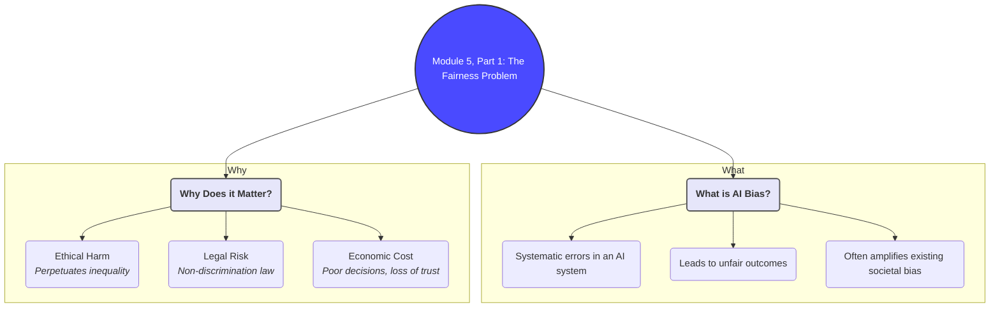
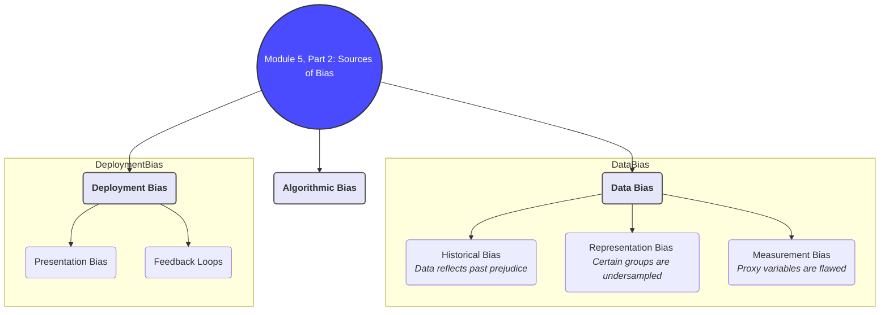
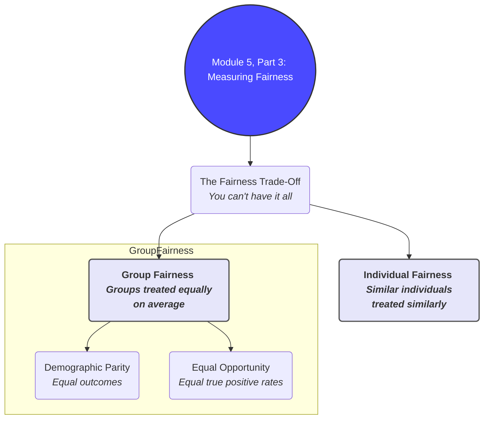
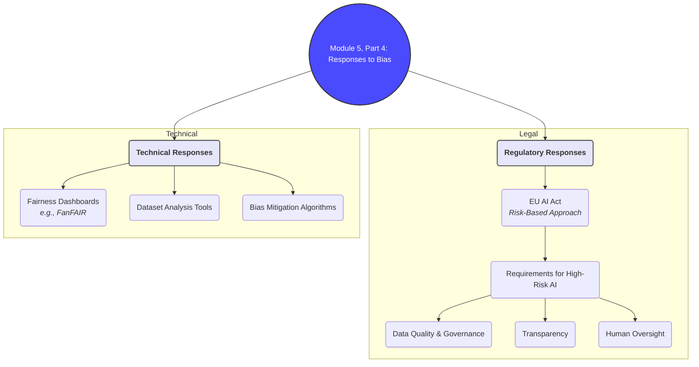

# Brief Summary of Module 5: AI Fairness, Bias, and Data Quality

This summary provides a concise overview of the essential concepts from Module 5, drawing from the core lecture (`Lezioni Tilburg 2025.md`) and integrating key ideas from supplementary materials on identifying and assessing fairness in data-driven systems.

## 1. The Problem of AI Fairness and Bias

As AI systems become more integrated into society (e.g., in hiring, credit scoring, and justice), ensuring they are "fair" and do not discriminate is a critical challenge. Bias in AI does not typically arise from malicious intent but from the data and processes used to build the systems.

### What is AI Bias?
AI bias refers to systematic and repeatable errors in a computer system that create unfair outcomes, such as privileging one arbitrary group of users over others. It often mirrors and can even amplify existing societal biases.

### Why it Matters
- **Ethical Harm**: Unfair systems can perpetuate inequality and harm individuals' life chances.
- **Legal Risk**: Biased AI can lead to violations of non-discrimination laws.
- **Economic Cost**: Flawed decision-making leads to poor outcomes and loss of public trust.

The core challenge is that "fairness" is not a single, universally agreed-upon technical metric. It is a socio-technical concept that involves trade-offs.
*(Source: `Module_5/Lezioni Tilburg 2025.md`)*

## 2. Sources of Bias in the AI Lifecycle

Bias is not a single failure but can creep in at multiple stages of AI development and deployment. Understanding these sources is key to mitigating them.

### Key Sources of Bias
1.  **Data Collection Bias**: The data used to train the model is flawed.
    - **Historical Bias**: The data reflects past and present societal prejudices (e.g., historical hiring data shows fewer women in leadership roles).
    - **Representation Bias**: The data under-represents certain groups, leading the model to perform poorly for them.
    - **Measurement Bias**: The way data is collected or measured varies in quality across groups (e.g., using arrests as a proxy for crime).
2.  **Algorithmic Bias**: The model itself introduces or amplifies bias. This can happen through the choice of algorithm or the way it optimizes for a certain objective, which may inadvertently correlate with sensitive attributes like race or gender.
3.  **Deployment & Interaction Bias**: Bias is created after the system is deployed.
    - **Presentation Bias**: The way a system presents information can shape user interpretation and reinforce stereotypes.
    - **Feedback Loops**: The model's own predictions can influence the real world, creating new, biased data that is then used to retrain the model (e.g., a predictive policing model sends more police to an area, leading to more arrests and "confirming" the model's prediction).

*(Source: `Module_5/Lezioni Tilburg 2025.md`, `Module_5/Identifying Bias in Data Collection.md`)*

## 3. Defining and Measuring Fairness

There is no single mathematical definition of fairness. Different metrics exist, and they are often mutually exclusive. Choosing a fairness metric is a normative decision about what kind of fairness is most important in a given context.

### Common Types of Fairness Metrics
- **Group Fairness**: Aims to ensure that different demographic groups are treated similarly on average.
    - **Demographic Parity**: The likelihood of a positive outcome (e.g., getting a loan) is the same for all groups.
    - **Equal Opportunity**: The likelihood of a *correct* positive outcome (true positive rate) is the same for all groups. This is less restrictive and often preferred.
- **Individual Fairness**: Aims to ensure that similar individuals are treated similarly, regardless of their group identity.

The **"Impossibility Theorem of Fairness"** shows that, except in trivial cases, it is impossible to satisfy multiple key group fairness metrics simultaneously. This means regulators and developers must make a choice about which fairness goals to prioritize.
*(Source: `Module_5/Lezioni Tilburg 2025.md`)*

## 4. Regulatory and Technical Responses to Bias

Both legal frameworks and technical tools are being developed to address AI bias. The EU AI Act is a key regulatory example, while tools like fairness dashboards aim to provide practical solutions.

### The EU AI Act
The AI Act takes a risk-based approach. For **high-risk AI systems**, it imposes several requirements aimed at ensuring fairness and data quality:
- **Data Governance and Quality**: Mandates that training data be "relevant, representative, free of errors and complete." This directly targets data bias.
- **Transparency**: Requires clear documentation for users and authorities about the system's capabilities and limitations.
- **Human Oversight**: Ensures that humans can intervene or oversee the system's decisions.
- **Accuracy, Robustness, and Cybersecurity**: Sets technical standards to ensure the system functions reliably.

### Technical Tools for Fairness Assessment
To comply with regulations and ethical goals, developers use various tools to audit their models and data:
- **Fairness Dashboards**: Tools that automatically calculate and visualize different fairness metrics for a model (e.g., FanFAIR).
- **Dataset Analysis Tools**: Methods to automatically assess datasets for potential biases before they are used for training, sometimes using techniques like fuzzy logic to handle uncertainty.

These tools do not "solve" fairness but make the trade-offs visible, allowing developers and stakeholders to make more informed decisions.
*(Source: `Module_5/Lezioni Tilburg 2025.md`, `Module_5/Investigating Fairness with FanFAIR.md`, `Module_5/Investigating Semi-Automatic Assessment of Data Sets Fairness by Means of Fuzzy Logic.md`)*

