# Module 5: AI and Data Regulation – Consolidated Summary

**Module Title:** AI and Data Regulation  
**Instructor:** Avv. Chiara Gallese Nobile, Ph.D., CIPP/E, MSCA, Tilburg University, TILT  
**Date:** 07/10/2025

This consolidated document synthesizes the essential concepts from Module 5, integrating comprehensive legal frameworks, regulatory requirements, and practical guidance on bias and fairness assessment. It combines the depth of the extensive lecture materials with visual representations to support understanding of complex topics.

---

## Table of Contents

1. [Introduction: The Data Collection Crisis](#introduction)
2. [GDPR Foundational Principles](#gdpr-foundations)
3. [The EU AI Act Risk-Based Framework](#eu-ai-act)
4. [AI Ethics and Trustworthy AI](#ai-ethics)
5. [Bias, Fairness, and Data Quality](#bias-fairness)
6. [Practical Implementation and Case Studies](#practical)
7. [Key Takeaways](#conclusions)

---

## Introduction: The Data Collection Crisis {#introduction}

### Recent High-Profile Cases and the Pattern of Wrongdoing

The foundation of machine learning is data, yet the methods for collecting and using this data remain fraught with legal and ethical pitfalls. Three major companies—**IBM**, **ClearviewAI**, and **OpenAI**—serve as cautionary tales of wrongful data practices.

**IBM's Case: Biometric Data Scraping**

IBM scraped the web indiscriminately to collect random people's images to train facial recognition systems without consent or transparency. This processing of biometric data violated Article 9(1) of the GDPR (special categories of personal data), lacked transparency under Article 5(1)(a), and had no valid legal basis under Article 6.

**ClearviewAI: Facial Recognition for Law Enforcement**

ClearviewAI aggregated billions of images scraped from social media into a massive facial recognition database sold to law enforcement. This created systems designed to enable mass surveillance and uniquely identify natural persons through biometric means—a practice now explicitly banned under the EU AI Act. The company faced a €20 million GDPR fine in Europe.

**OpenAI: ChatGPT and Mass Data Scraping**

OpenAI scraped the web indiscriminately, collecting personal data, copyrighted texts, and code. This violated the **purpose limitation principle** (Article 5(1)(b) GDPR)—data collected for one purpose being used for another—and lacked transparency and valid legal basis. Italy became the first Western nation to ban ChatGPT in March 2023, citing GDPR violations.

**Common Pattern:** Unlawful data scraping, lack of transparency, and unauthorized use of protected materials.

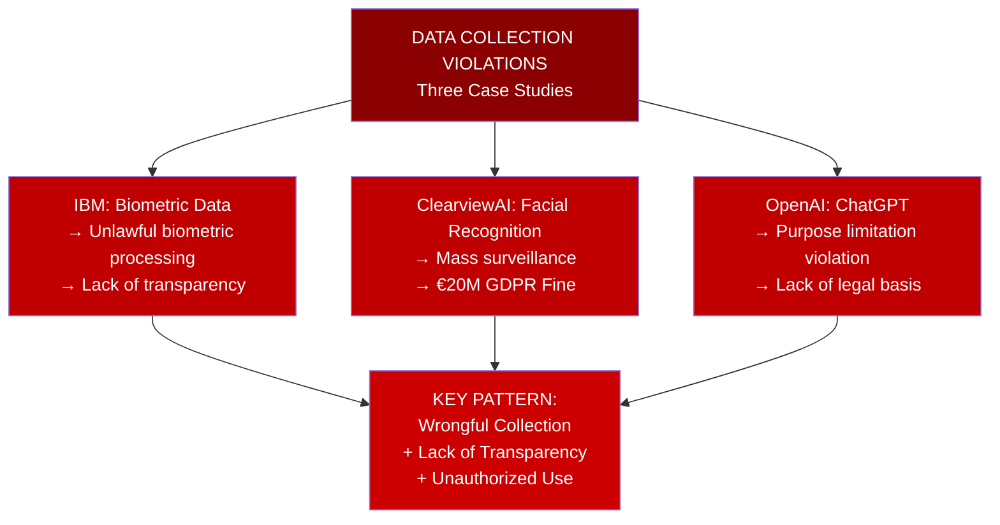

### The Misconception: "Publicly Available" ≠ "Public Domain"

A fundamental misunderstanding underlies these violations: the belief that publicly accessible data can be freely used. In reality, five distinct legal and ethical frameworks govern online data use.

#### 1. Copyright Law

Publicly visible content remains copyrighted. This includes logos, databases, text, images, videos, software code, and graphics. Using copyrighted material to train AI without authorization constitutes copyright infringement, even if the content is publicly accessible on a website. Disney+ images, for example, are visible but protected by copyright.

#### 2. Data Protection Law (GDPR and Convention 108+)

Personal data of living persons remain protected even when publicly visible. Names, email addresses, photos on websites are covered by the General Data Protection Regulation (applicable in the EU across 27 Member States) and Convention 108+ (applicable in 55 countries). The fact that someone has made their information public on social media does not waive their data protection rights.

#### 3. Web Scraping Laws (DSM Directive)

The **Directive (EU) 2019/790 on copyright and related rights in the Digital Single Market** provides an exception for text and data mining (TDM) from copyright restrictions, but with a critical opt-out mechanism. Rights holders can exclude their content by specifying restrictions in machine-readable formats (e.g., `robots.txt` files, HTML meta tags). Importantly, this exception does NOT apply to commercial AI training.

#### 4. Contract Law

Website Terms of Service constitute binding contracts that can explicitly prohibit automated data collection and scraping. Violating these terms creates contractual liability. The landmark case **LinkedIn Corp. v. hiQ Labs Inc.** emphasized that breach of contractual scraping prohibitions can create legal liability, even when the data is technically public.

#### 5. Ethics

Beyond legal requirements, ethical principles establish that using data without consent, information, or for potentially harmful purposes violates human autonomy and dignity. International frameworks (EU AI HLEG Guidelines, UNESCO Recommendation on AI Ethics, OECD AI Principles) emphasize respect for human autonomy, prevention of harm, fairness, and transparency.

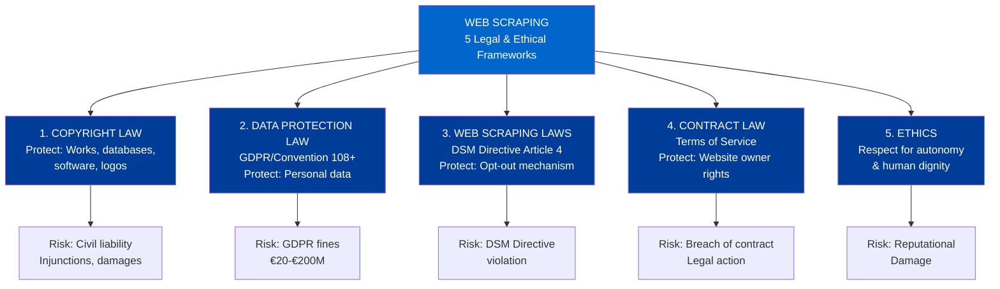

### Legal Precedents in Web Scraping

**Ryanair v. Volagratis/Lastminute (EU)**

Price-comparison websites scraped flight information from Ryanair's database. The court ruled that scraping was lawful because Ryanair's database lacked "creative intellectual contribution" and the purpose (price comparison) had consumer protection rationale. However, **this case does not apply to AI training**, which is a fundamentally different purpose.

**LinkedIn Corp. v. hiQ Labs Inc. (US)**

hiQ scraped public LinkedIn profiles for business analytics. The legal battle highlighted the tension between public data access and contractual terms. The final ruling emphasized **contract liability**: violating a website's user agreement that prohibits scraping creates legal liability, separate from criminal law considerations.

**Ryanair DAC v. Booking Holdings Inc. (US)**

Under the Computer Fraud and Abuse Act, scraping publicly available information without authentication (passwords) is not a violation. However, cease-and-desist letters can withdraw authorization to access protected (authenticated) portions of websites.

---

## GDPR Foundational Principles {#gdpr-foundations}

### The Hierarchical Nature of Legal Instruments

The GDPR does not exist in isolation. Legal instruments are arranged hierarchically, from highest to lowest authority:

1. International Conventions and Treaties (e.g., European Convention on Human Rights, Convention 108+)
2. EU Primary Law (EU Treaties, Charter of Fundamental Rights)
3. EU Secondary Law (GDPR, Directives)
4. National Constitutions
5. National Implementing Laws
6. National Administrative Regulations

When conflicts arise, higher-ranking instruments prevail. The GDPR, as an EU Regulation, has direct effect across all Member States but must be interpreted in light of the Charter of Fundamental Rights.

### Scope and Core Definitions

#### When the GDPR Applies

The GDPR applies when:
- A data controller or processor is established in the EU (regardless of where processing occurs)
- Activities target subjects located in the EU (even if the controller is outside the EU)
- Competent authorities process data for non-law-enforcement purposes

**Data subject's nationality does not matter.** What matters is whether they are in the EU or targeted by services.

**When the GDPR does NOT apply:**
- Personal or household activities (e.g., personal photos on a private device)
- Law enforcement processing for criminal purposes (covered by separate LED Directive)
- EU institutions' activities (covered by separate Regulation 2018/1725)

#### Personal Data (Article 4(1))

"Personal data" means any information relating to an identified or identifiable natural person. This encompasses:

- **Biometric data**: Photos, fingerprints, video recordings
- **Genomic data**: DNA sequences, genetic markers
- **Profiling**: Habits, preferences, shopping/viewing patterns
- **Identifiers**: Nicknames, usernames, device IDs
- **Location data**: GPS coordinates, home addresses
- **Opinions**: Religious beliefs, philosophical beliefs
- **Feelings**: Emotional states, burnout information
- **Financial information**: Income, credit reliability

Personal data can be in **any format**, including mathematical representations (embeddings, vectors in machine learning models).

#### Processing (Article 4(2))

Processing encompasses virtually any action taken with data:
- Collection, recording, organization, storage
- Modification, analysis, deletion
- Sharing, dissemination, access through VPN
- **Training a machine learning model**
- **Reading or consulting data**

**Critical point:** Data collection for AI is a form of processing, so GDPR applies from the moment data gathering begins.

### The Seven GDPR Principles (Article 5)

The GDPR is built on seven core principles that govern all data processing:

**1. Lawfulness, Fairness, and Transparency (Article 5(1)(a))**

Processing must have a valid legal basis, be fair to the data subject, and be transparent. In machine learning:
- Ensure you have the right to use the data
- Respect applicable licenses
- Inform data subjects how their data is used
- Provide accessible privacy notices

**2. Purpose Limitation (Article 5(1)(b))**

Data must be collected for specified, explicit, and legitimate purposes and not further processed in incompatible ways. You cannot collect data "just in case." If collected for one purpose (e.g., customer support), using it for AI training requires justification that the new purpose is compatible or a new legal basis.

**3. Data Minimization (Article 5(1)(c))**

Only data strictly necessary for each specific purpose should be collected. Avoid over-collection. For AI training, this means carefully selecting which attributes are essential to the model's purpose.

**4. Accuracy (Article 5(1)(d))**

Personal data must be kept correct and up-to-date. Inaccurate data must be rectified or erased. This is particularly important for AI, as inaccurate training data propagates errors through the model.

**5. Storage Limitation (Article 5(1)(e))**

Data should be kept in a form permitting identification of data subjects for no longer than necessary. For AI, this may mean securely deleting training data once models are deployed, or having clear retention policies.

**6. Integrity and Confidentiality (Article 5(1)(f))**

Data must be processed with appropriate security measures protecting against unauthorized or unlawful processing, accidental loss, destruction, or damage. This includes technical measures like encryption and organizational measures like access controls.

**7. Accountability (Article 5(2))**

The data controller is responsible for demonstrating compliance with all principles. This requires:
- Documentation of processing activities (Records of Processing, Article 30)
- Data Protection Impact Assessments (Article 35) when required
- Compliance monitoring and reporting

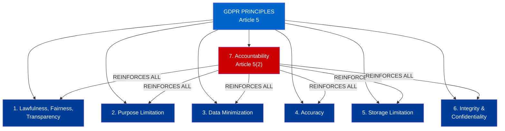

### Legal Basis for Processing (Article 6)

Processing is only lawful when a valid legal basis exists. Six bases are available:

1. **Consent (Article 6(1)(a))**: The data subject has freely given, specific, informed, and unambiguous consent. For special categories of data, consent must be explicit. Consent can be withdrawn at any time.

2. **Contract (Article 6(1)(b))**: Processing is necessary to perform a contract or prepare to enter into one.

3. **Legal Obligation (Article 6(1)(c))**: Processing is required by EU or national law.

4. **Vital Interests (Article 6(1)(d))**: Processing is necessary to protect vital interests (life, health) of the data subject or another person.

5. **Public Task (Article 6(1)(e))**: Processing is necessary for a task carried out in the public interest or official authority function.

6. **Legitimate Interest (Article 6(1)(f))**: Processing is necessary for legitimate interests pursued by the controller or a third party, except where such interests are overridden by the interests, rights, and freedoms of the data subject. This requires a Legitimate Interest Assessment (LIA) balancing controller interests against data subject rights.

For AI development, **Legitimate Interest** and **Consent** are most commonly used for training on public datasets.

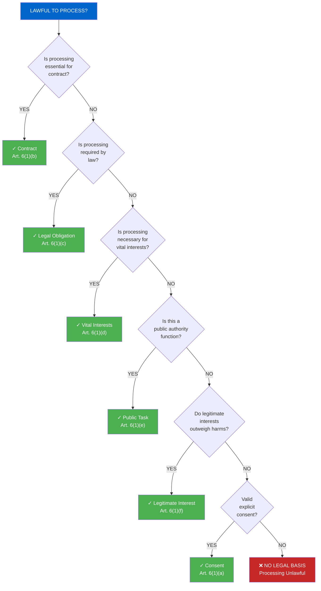

### Special Categories of Data (Article 9)

Article 9 generally prohibits processing of eight special categories of personal data:

1. Racial or ethnic origin
2. Political opinions
3. Religious or philosophical beliefs
4. Trade union membership
5. Genetic data
6. **Biometric data for identification purposes**
7. Health data
8. Sex life or sexual orientation data

These categories receive heightened protection because of their sensitivity and potential for discrimination.

**Exceptions** allowing processing include:
- Explicit consent
- Employment and social security law obligations
- Vital interests (life or health protection)
- Manifestation of publicly shared data
- Legal claims
- Public health interests
- Archiving, research, or statistical purposes

**Critically for AI:** Article 9(2)(h) allows processing of special categories when "necessary for the purposes of the preventive or occupational medicine, for assessing the working capacity of the employee... or for monitoring and improving performance at work" under appropriate safeguards.

Furthermore, the AI Act allows processing of special categories for **bias monitoring, detection, and correction** when strictly necessary and proportionate—providing organizations a substantial basis to audit their systems for discriminatory impacts.

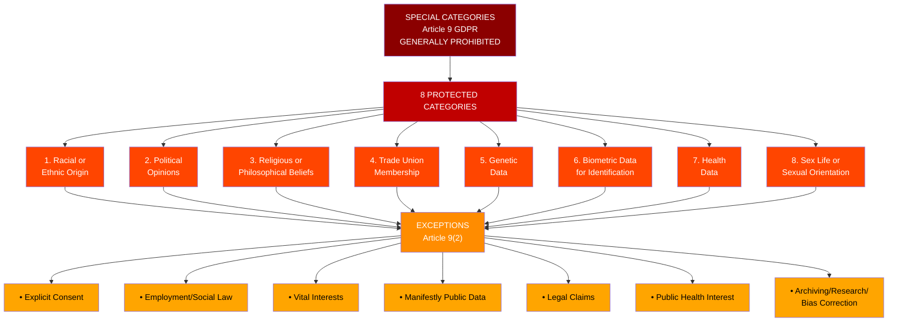

---

## The EU AI Act Risk-Based Framework {#eu-ai-act}

The **EU AI Act**, the world's first comprehensive AI regulation, takes a **risk-based approach** to governance. Rather than applying identical rules to all AI systems, it classifies systems into four tiers based on the risk they pose to safety, fundamental rights, and democratic values.

### Defining AI Systems (Article 3)

An AI system is a "machine-based system designed to operate with some degree of autonomy and that can, for explicitly defined or learned objectives, generate outputs such as content, predictions, recommendations or decisions influencing the physical or virtual environments."

This broad definition captures most machine learning systems, from recommender algorithms to large language models to computer vision systems.

### Four-Tier Risk Classification

#### Tier 1: Unacceptable Risk (Prohibited)

These AI systems are deemed a clear threat to safety, livelihoods, and fundamental rights. They are **outright banned**:

**1. Real-Time Remote Biometric Identification in Public Spaces**

AI systems that perform real-time remote biometric identification of individuals in publicly accessible spaces by law enforcement are prohibited. This targets mass surveillance technologies (e.g., ClearviewAI) that can enable discriminatory policing and undermine freedom of assembly.

Narrow exceptions exist for:
- Targeted search for specific individuals (wanted for serious crime)
- Prevention of imminent threats
- Scientific research under strict conditions

**2. Social Credit Systems**

AI systems that assign "social scores" to individuals or groups by public authorities, leading to discriminatory treatment, are banned. These systems risk enabling Orwellian surveillance and punishment based on algorithmic judgment.

**3. Subliminal Manipulation**

AI systems designed to deploy subliminal techniques—often imperceptible to humans—to distort behavior and decision-making. This includes dark patterns, deepfakes for disinformation, and psychological manipulation.

**4. Exploitation of Vulnerable Groups**

AI systems that exploit vulnerabilities of specific groups (children, elderly, persons with disabilities) to distort their behavior in ways harmful to their interests.

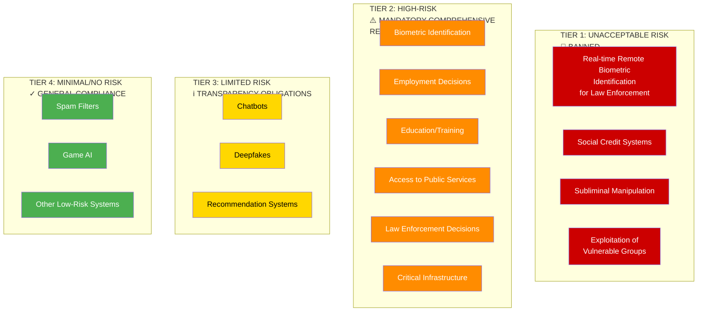

#### Tier 2: High-Risk Systems

These systems are not banned but subject to stringent requirements before deployment. High-risk systems include those used in:

- **Biometric Identification and Categorization**: Systems identifying or categorizing individuals based on biometric data (fingerprints, facial features, gait)
- **Critical Infrastructure Management**: Systems controlling essential services (transportation, energy, water)
- **Education and Vocational Training**: Systems determining educational placement or training opportunities
- **Employment and Workers Management**: Recruitment, performance evaluation, promotion systems
- **Access to Essential Public and Private Services**: Credit scoring, insurance, housing, healthcare eligibility
- **Law Enforcement**: Predicting criminal offenses, assessing risk, guidance for investigations
- **Migration and Asylum Administration**: Assessing applications, determining eligibility
- **Administration of Justice**: Supporting judicial decisions, case outcome prediction
- **Biometric Processing**: Registration or verification of biometric data

#### Tier 3: Limited Risk

Systems with limited risk require **transparency obligations**:

- **AI-Generated Content Disclosure**: Users must be informed when interacting with AI systems (e.g., chatbots) or when content is AI-generated (deepfakes, synthetic media)
- **Recommendation Systems**: Systems recommending content must disclose their operation and allow user control

#### Tier 4: Minimal or No Risk

The vast majority of AI systems fall here (spam filters, game AI, autocomplete) and face no additional obligations beyond general GDPR compliance.

### Mandatory Requirements for High-Risk AI Systems (Articles 8-15)

The AI Act imposes seven core requirements for high-risk systems:

**1. Risk Management System (Article 9)**

A continuous process throughout the system's lifecycle to:
- Identify potential risks and hazards
- Analyze and evaluate identified risks
- Implement risk mitigation measures
- Monitor effectiveness of mitigation
- Reassess risks continuously

**2. Data and Data Governance (Article 10)** ★ *Most critical for bias mitigation*

Training, validation, and testing datasets must be:
- **Relevant**: Suited to the intended purpose
- **Representative**: Covering relevant populations and use contexts
- **Free of errors**: Accurate, with quality checks
- **Complete**: Sufficient data without systematic gaps

Datasets must be examined for:
- **Possible biases**: Systematic disparities by protected characteristics
- **Discrimination risks**: Features that could enable unfair treatment
- Specific context in which the AI will operate

**Critically:** The Act allows processing of special categories of personal data (ethnicity, health data, etc.) when strictly necessary for **bias monitoring, detection, and correction**—providing a substantial public interest legal basis for auditing systems for discriminatory impacts.

**3. Technical Documentation (Article 11)**

Comprehensive documentation must be maintained demonstrating:
- System description and intended purpose
- Training data characteristics and sources
- Data preprocessing steps
- Validation and testing methodologies and results
- Performance metrics and limitations
- Human oversight measures
- Post-deployment monitoring plans

**4. Record-Keeping (Logs) (Article 12)**

Systems must automatically log events to ensure traceability of operation, including:
- Usage events and decisions
- Error events
- Performance variations
- Maintenance and updates
- User interactions and feedback

**5. Transparency and Provision of Information (Article 13)**

Users and affected parties must receive clear information:
- That they are interacting with an AI system
- The system's intended purpose
- Capabilities and limitations
- Expected accuracy and failure modes
- Restrictions on use
- Rights and remedies available
- How to contact responsible persons

**6. Human Oversight (Article 14)**

Systems must be designed to enable meaningful human control:
- Humans "in the loop" during decision-making
- Humans must understand system operations and recommendations
- Humans must be able to override, stop, or refuse system outputs
- Override mechanisms must be accessible and effective

**7. Accuracy, Robustness, and Cybersecurity (Article 15)**

Systems must be:
- **Accurate**: Correct outputs within specified tolerance levels
- **Robust**: Resilient against errors, faults, and anomalies
- **Cybersecure**: Protected against unauthorized alteration, manipulation (data poisoning, adversarial attacks)

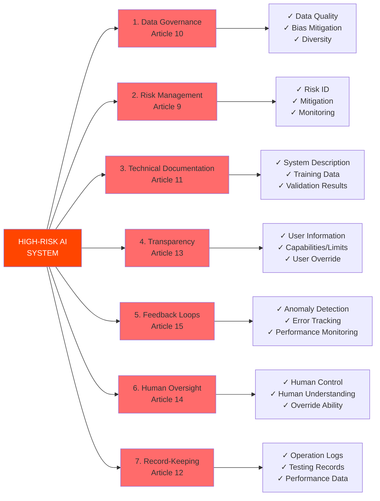

---

## AI Ethics and Trustworthy AI {#ai-ethics}

Beyond legal compliance, international frameworks establish ethical principles for trustworthy AI. The **AI HLEG (High-Level Expert Group) Guidelines** and **UNESCO Recommendation on AI Ethics** define seven ethical principles:

### The Seven Ethical Principles

**1. Human Agency and Oversight**

AI systems should support human autonomy and enable meaningful human control. Humans should remain "in the loop" with ability to understand, contest, and override AI decisions. AI should enhance human capabilities rather than replacing human judgment entirely.

**2. Technical Robustness and Safety**

AI systems must be reliable, accurate, and resilient. They should fail gracefully and include safeguards against misuse. Security against adversarial attacks and data poisoning is essential.

**3. Privacy and Data Governance**

AI development requires careful data governance ensuring GDPR compliance, data minimization, and protection of sensitive information. Privacy by design and default should be embedded from the outset.

**4. Transparency**

AI systems should be explainable and transparent. Users should understand:
- That they are interacting with AI
- How the system makes decisions
- What capabilities and limitations exist
- What data it uses

**5. Accountability**

Clear responsibility chains must exist for AI systems. Organizations should be able to explain and justify decisions, with documented processes and external auditing where appropriate.

**6. Fairness and Non-Discrimination**

AI systems must not discriminate based on protected characteristics. This requires:
- Identifying discrimination risks early
- Testing models for disparate impact across groups
- Implementing bias mitigation techniques
- Continuous monitoring post-deployment

**7. Social and Environmental Well-being**

AI should contribute positively to society and the environment. Systems should be assessed for:
- Societal impact (access, equity, inclusion)
- Environmental sustainability (energy use, resource consumption)
- Long-term beneficial effects

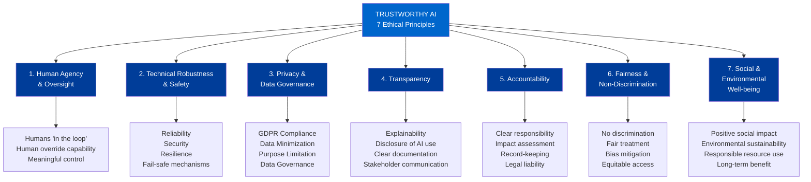

---

## Bias, Fairness, and Data Quality {#bias-fairness}

A central challenge in AI governance is addressing bias. Biased AI systems can perpetuate and amplify existing societal inequities, leading to ethical harms, legal violations, and loss of public trust.

### Defining Bias: The Friedman & Nissenbaum Framework

Researchers Batya Friedman and David Hendry Nissenbaum define three types of bias in computer systems:

**Type 1: Preexisting Bias**

Societal bias that exists before AI systems are built and is reflected in historical data. For example, if women were historically excluded from certain professions, training data from those professions will show gender imbalance. The algorithm learns this historical bias from the data.

*Example:* Amazon's hiring algorithm learned historical gender bias from decades of hiring data where men dominated technical roles, leading the system to downrank women applicants.

**Type 2: Technical Bias**

Bias introduced by technical choices in system design:
- Data collection methodology
- Feature selection and engineering
- Algorithm choice
- Training data split (train/test)
- Hyperparameter tuning
- Decision thresholds

*Example:* Facial recognition systems trained primarily on light-skin tones often fail dramatically on dark-skin faces. This technical bias arose from dataset composition choices, not societal bias per se.

**Type 3: Interaction Bias**

Bias that emerges from how humans interact with and use AI systems:
- User misunderstanding of system capabilities
- Gaming the system (e.g., manipulating inputs to get desired outputs)
- Feedback loops (system predictions affecting reality, creating new biased data)
- Context drift (system trained on one context, deployed in another)

*Example:* Predictive policing systems create feedback loops. If the system recommends more police presence in low-income neighborhoods, more arrests occur there, which the system interprets as confirmation that the area is "high crime," reinforcing the prediction.

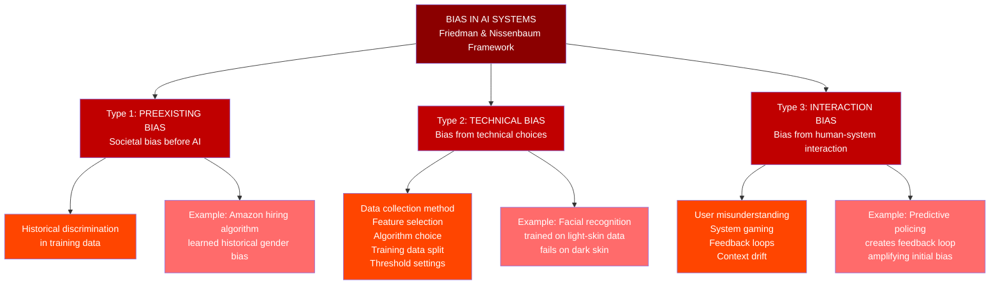

### Why Bias Matters

**Ethical Harm:** Biased AI systems perpetuate inequality and harm individuals' life chances. Discrimination in hiring, lending, criminal justice, or healthcare can devastate lives.

**Legal Risk:** Biased AI violates non-discrimination laws (EU Equal Treatment Directives, Title VII in the US, national laws). Regulators are increasingly holding companies liable for algorithmic discrimination.

**Economic and Reputational Cost:** Flawed decision-making leads to poor outcomes. Public discovery of bias causes reputational damage and loss of trust, threatening business viability.

**Systemic Amplification:** Bias in AI can amplify societal inequities over time through feedback loops. A system that sends more police to certain neighborhoods creates more arrests there, "confirming" the system's biased prediction and justifying continued overpolicing.

### Bias and the EU AI Act

The AI Act explicitly addresses bias in several provisions:

- **Recital 33:** "AI systems should be designed and developed in a way that respects... the principle of non-discrimination" and should be tested for "bias during the design phase and bias mitigation measures."
- **Article 10:** High-risk AI must examine training data for "possible biases" and discrimination risks.
- **Article 15:** Systems must monitor for errors and anomalies that could indicate emerging bias.

### Assessing Data Quality: The FAnFAIR Framework

The **FAnFAIR Framework** (Fuzzy Approach to Fairness Assessment in Datasets) provides a structured method for assessing dataset fairness across six dimensions:

**1. Balance (Class Imbalance)**

Are classes/groups evenly distributed? Severe imbalance (e.g., 99% negative examples, 1% positive) causes models to perform poorly on minority classes.

**2. Numerosity (Sample Size)**

Are there sufficient samples for learning? Each group/class should have adequate representation for the model to learn reliable patterns.

**3. Unevenness (Distributional Consistency)**

Is the distribution of attributes uniform across demographic groups? Uneven distribution (e.g., age varies more in one gender group) can lead to disparate impacts.

**4. Compliance (Constraint Satisfaction)**

Do values conform to specified constraints? Invalid or spurious values (e.g., age = 999) degrade data quality.

**5. Quality (Accuracy and Consistency)**

Are records complete and accurate? Errors, inconsistencies, and missing values in training data propagate through models.

**6. Incompleteness (Missing Data)**

What proportion of values are missing? High missingness can bias estimates and reduce model reliability.

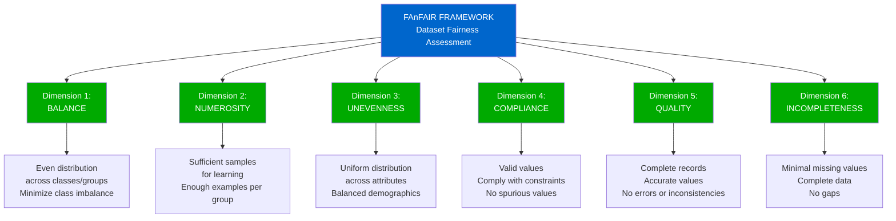

### Practical Case Study: Bias in Pharmaceutical Research

A compelling example of bias cascades involves pharmaceutical research:

**The Problem:** Historically, clinical trials excluded minorities, women, and elderly persons. Drug efficacy and dosing were developed based on predominantly white male populations.

**The Cascade:**
1. **Biased Data Collection** → Trials excluded minorities
2. **Biased Training Data** → Models learned from unrepresentative data
3. **Biased Model Deployment** → Dosing/efficacy determined by majority group data
4. **Biased Health Outcomes** → Minorities receive suboptimal treatment
5. **Feedback Loop** → Poor outcomes attributed to other factors, bias perpetuated
6. **Cycle Repeats** → Bias embedded in future research

This demonstrates how bias in data collection creates cascading harms throughout a system's lifecycle.

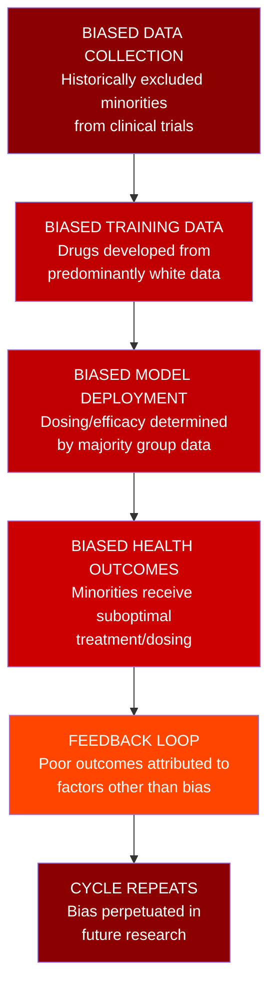

### Data Balancing and Preprocessing Techniques

When datasets exhibit class imbalance, several techniques can rebalance them:

**Oversampling Minority Classes**
- Random duplication: Simply repeating minority class examples
- SMOTE (Synthetic Minority Over-sampling Technique): Generating synthetic examples via interpolation
- ADASYN (Adaptive Synthetic Sampling): Adaptively emphasizing harder cases
- Risk: Overfitting to minority class patterns

**Undersampling Majority Classes**
- Random removal: Randomly discarding majority class examples
- Stratified sampling: Removing examples while maintaining distribution properties
- Near-miss: Removing examples near decision boundaries
- Risk: Information loss

**Synthetic Data Generation**
- Generative models: Using GANs or VAEs to create realistic synthetic examples
- Copulas: Statistical models capturing dependencies between variables
- Domain-based generation: Creating examples aligned with domain knowledge
- Advantage: Realistic, diverse examples without information loss

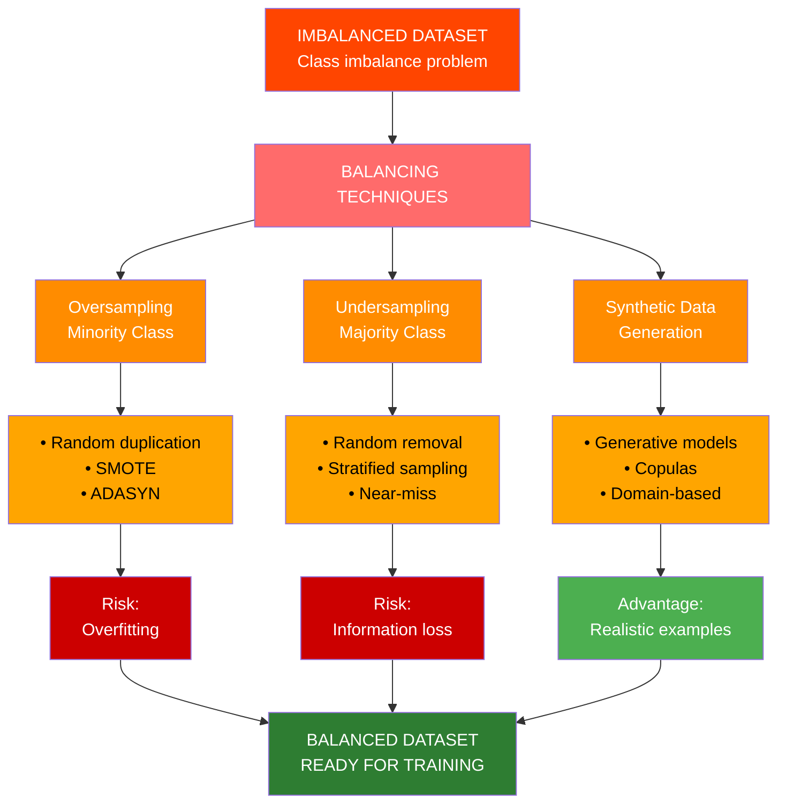

### Machine Learning Lifecycle with Fairness Checkpoints

Fairness is not a one-time consideration but requires monitoring throughout the ML lifecycle:

**Stage 1: Define Objectives**
- Identify protected characteristics (race, gender, age, disability, etc.)
- Consider all stakeholders affected
- Define fairness criteria appropriate to context
- Establish fairness metrics to track

**Stage 2: Acquire and Explore Data**
- Use tools like FAnFAIR to assess data fairness
- Audit data for bias across demographic groups
- Check representativeness (all relevant populations included)
- Apply data balancing if severe imbalance detected

**Stage 3: Model and Train**
- Test model performance separately for each demographic group
- Check for disparate impact (unequal error rates across groups)
- Use fairness-aware algorithms that incorporate fairness constraints
- Monitor feature importance to identify proxies for protected attributes

**Stage 4: Interpret and Communicate**
- Explain model limitations and failure modes
- Communicate bias risks to stakeholders
- Discuss mitigation strategies undertaken
- Disclose discrimination risks to end users

**Stage 5: Implement and Maintain**
- Monitor performance by demographic group post-deployment
- Collect user feedback about fairness
- Retrain when performance disparities emerge
- Conduct regular fairness audits

```mermaid
graph LR
    A["Stage 1:<br/>DEFINE OBJECTIVES"] -->|Fairness:| A1["Identify protected<br/>characteristics<br/>Consider stakeholders<br/>Define fairness criteria"]
    
    A1 --> B["Stage 2:<br/>ACQUIRE & EXPLORE DATA"]
    B -->|Fairness:| B1["Use FAnFAIR to assess<br/>Audit for bias<br/>Check representativeness<br/>Data balancing if needed"]
    
    B1 --> C["Stage 3:<br/>MODEL DATA"]
    C -->|Fairness:| C1["Test by demographic group<br/>Check disparate impact<br/>Fairness-aware algorithms<br/>Monitor feature importance"]
    
    C1 --> D["Stage 4:<br/>INTERPRET &<br/>COMMUNICATE"]
    D -->|Fairness:| D1["Explain limitations<br/>Communicate risks<br/>Discuss mitigation<br/>Disclose discrimination risk"]
    
    D1 --> E["Stage 5:<br/>IMPLEMENT &<br/>MAINTAIN"]
    E -->|Fairness:| E1["Monitor by demographic group<br/>Collect feedback<br/>Retrain when disparities emerge<br/>Regular fairness audits"]
    
    style A fill:#0066cc,color:#fff
    style B fill:#0066cc,color:#fff
    style C fill:#0066cc,color:#fff
    style D fill:#0066cc,color:#fff
    style E fill:#0066cc,color:#fff
    
    style A1 fill:#4CAF50,color:#fff
    style B1 fill:#4CAF50,color:#fff
    style C1 fill:#4CAF50,color:#fff
    style D1 fill:#4CAF50,color:#fff
    style E1 fill:#4CAF50,color:#fff
```

---

## Practical Implementation and Case Studies {#practical}

### Case Study: Mozilla Common Voice Dataset

The Mozilla Common Voice project aims to create an open-source speech dataset for training speech recognition systems. The project revealed fairness challenges:

**Bias Issue:** Early versions of the dataset showed underrepresentation of certain accents and languages, leading to speech recognition models that worked well for English speakers with standard accents but poorly for speakers of other languages or non-standard accents.

**Resolution:** Mozilla actively worked to recruit speakers from underrepresented linguistic communities, achieving greater demographic and linguistic diversity in the dataset.

**Lesson:** Proactive curation and outreach are necessary to ensure datasets are representative of the populations they serve.

### Case Study: COVID-19 Datasets and FAnFAIR Application

During the COVID-19 pandemic, researchers used FAnFAIR to assess datasets used for epidemiological modeling:

**Findings:** COVID-19 datasets often showed:
- Underrepresentation of elderly and immunocompromised populations in clinical trial data
- Geographic imbalance (data concentrated in wealthy nations)
- Incomplete data on comorbidities affecting vulnerable groups
- Class imbalance (recovered cases vs. severe cases)

**Application of FAnFAIR:** The framework identified these issues early, prompting:
- Targeted data collection efforts in underrepresented regions
- Augmentation of datasets for vulnerable populations
- Stratified analysis accounting for demographic differences

**Outcome:** Fairer datasets led to models with more equitable predictions across populations.

**Lesson:** Systematic fairness assessment using frameworks like FAnFAIR can catch and correct bias before models are deployed to real populations.

### Practical Steps for Bias Mitigation

**1. Pre-Collection:** Define who should be represented and ensure data collection reaches diverse populations.

**2. During Collection:** Use stratified sampling to ensure adequate representation of all groups. Monitor collection processes for measurement bias.

**3. After Collection:** Use FAnFAIR or similar frameworks to assess dataset fairness. Apply balancing techniques as needed.

**4. Model Development:** Test models separately for each demographic group. Use fairness-aware algorithms if standard approaches show disparities.

**5. Deployment:** Monitor performance for disparities. Collect feedback from affected communities. Retrain when disparities emerge.

**6. Governance:** Establish fairness review boards with interdisciplinary expertise (data scientists, domain experts, affected community representatives, ethicists).

---

## Key Takeaways {#conclusions}

### Legal Landscape

1. **"Publicly available" ≠ "public domain"**: Five legal and ethical frameworks govern data use: copyright law, data protection law, web scraping law, contract law, and ethics.

2. **GDPR applies to AI**: Data collection for machine learning is processing under GDPR. Seven principles govern all processing: lawfulness, purpose limitation, minimization, accuracy, storage limitation, confidentiality, and accountability.

3. **Legal basis is essential**: Valid legal basis (consent, legitimate interest, public task, etc.) must exist for processing. This must be documented and defensible.

4. **Special categories require heightened protection**: Biometric and other sensitive data are generally prohibited but can be processed for bias detection and correction.

5. **The EU AI Act sets comprehensive requirements**: High-risk AI systems must meet data governance, risk management, transparency, human oversight, and other requirements. Unacceptable risk systems are banned.

### Ethical and Technical Landscape

6. **Bias has multiple sources**: Preexisting bias (historical), technical bias (design choices), and interaction bias (deployment effects) all require attention.

7. **Fairness is not a technical problem alone**: Fairness involves normative judgments about what kind of fairness matters in context. Multiple fairness metrics exist and often conflict.

8. **Data quality is foundational**: Biased, incomplete, or unrepresentative data cascades through the AI lifecycle, creating unfair systems. FAnFAIR provides a framework for assessing data fairness.

9. **Fairness monitoring is continuous**: Bias doesn't end after deployment. Regular monitoring for disparities and feedback loops is essential.

10. **Trustworthy AI requires interdisciplinary effort**: Technical tools alone are insufficient. Fairness assessment requires collaboration between data scientists, domain experts, affected communities, ethicists, and legal experts.

---

**Generated:** November 2025  
**Purpose:** Consolidated reference for Module 5 on AI and Data Regulation  
**Sources:** Lezioni Tilburg 2025.md, comprehensive research papers on bias and fairness, GDPR, EU AI Act
